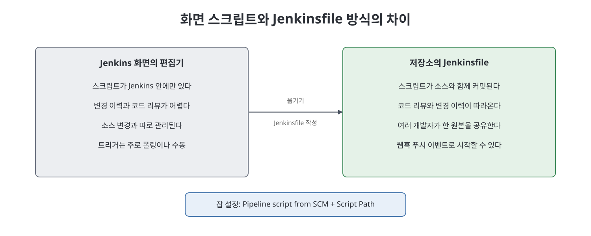
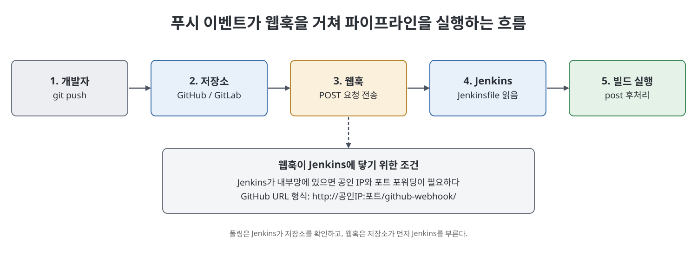

# 16장 Pipeline as Code (Understanding Pipeline as Code)

이 장은 세 가지 주제를 다룬다. 첫째는 비밀번호 대신 쓰는 API 인증(API access token)으로 GitHub와 GitLab 저장소에 접근하는 방법이다. 둘째는 파이프라인 스크립트를 Jenkins 화면이 아니라 저장소 안의 `Jenkinsfile`로 관리하는 Pipeline as Code이다. 셋째는 저장소에서 일이 생기면 Jenkins를 깨우는 웹훅(Webhook)이다. 앞 장들의 CalculatorAPI 프로젝트를 다시 소재로 삼아, 토큰으로 클론과 푸시를 하고, 선언형 파이프라인을 파일로 만들어 올리고, 푸시 이벤트로 빌드가 자동 실행되게 만든다.

> **쉽게 말하면**
> 빌드 레시피를 Jenkins 안이 아니라 소스 저장소 안에 넣어 두고, 저장소가 "코드가 올라왔어요" 하고 Jenkins에게 직접 알려 주게 만드는 장이다.

## 이 장의 흐름

1. API 인증이란 무엇이고 토큰은 어떻게 만들고 쓰는가
2. Jenkins에서 토큰으로 저장소에 접근하는 자격 증명 만들기
3. Jenkinsfile과 Pipeline as Code의 장점
4. 선언형 파이프라인 작성: `environment`, `post` 블록, `archiveArtifacts`, `emailext`
5. `Pipeline script from SCM`으로 Jenkinsfile 연결
6. 웹훅으로 잡 트리거(GitLab, GitHub)

## 1. API 인증과 토큰 사용

기본 인증(사용자 이름과 비밀번호)과 SSH 인증(공개 키와 개인 키) 외에, 비밀번호 자리에 쓰는 비밀 문자열인 API 액세스 토큰으로 인증하는 방법이 있다. 책은 이 방식이 Git 원격 저장소에 API 엔드포인트나 명령줄로 접근할 때 널리 쓰인다고 한다.

| 구분 | GitHub | GitLab |
|------|--------|--------|
| 메뉴 경로 | 아바타 > `Settings` > `Developer settings` > `Personal access tokens` > `Generate new token` | 아바타 > `Preferences` > `Access Tokens` |
| 입력 항목 | `Note`(용도 메모) | `Token name`(용도 메모) |
| 권한 범위(scope) | `repo` 체크(비공개 저장소 전체 권한) | `write_repository` 체크 |
| 생성 버튼 | `Generate token` | `Create personal access token` |

두 곳 모두 토큰은 페이지를 벗어나면 다시 볼 수 없으므로, 생성 직후 복사해서 따로 보관하라고 책은 강조한다.

토큰 사용 흐름은 이렇다. 빈 폴더에서 HTTPS URL로 `git clone`을 하면 로그인 창이 뜨고 비밀번호 칸에 토큰을 넣는다(GitHub는 `Personal Access Token` 칸, GitLab은 사용자 이름과 토큰). 한 번 입력하면 Windows 자격 증명 관리자(Windows Credentials)에 저장되어 이후 클론과 푸시에는 다시 묻지 않는다. 이전에 저장된 다른 자격 증명이 있으면 먼저 삭제하고 시도하라는 안내도 있다. 이어 파일을 고쳐 `git add`, `git commit`, `git push`를 하면 원격에 반영된다.

**Jenkins에서의 자격 증명**: 잡의 `Source Code Management`에서 `Git`을 고르고 HTTPS URL을 넣은 뒤 `Credentials`의 `Add`로 새 항목을 만든다. 이때 `Kind`는 `Username with password`로, `Username`에 계정 이름을, `Password`에 토큰을 넣는다. 책은 `Secret text`가 아닌 `Username with password`를 쓰라고 못 박는데, 저장소 접근에는 사용자 이름이 필요하기 때문이라고 이유를 든다. 그리고 `Invoke top-level Maven targets`에서 `MyMaven`과 `deploy` 목표로 빌드해 `pom.xml` 버전을 올릴 때마다 Nexus에 배포되는 것을 확인한다.

> **참고(노트 작성자)** 토큰은 비밀번호와 같은 비밀 값이다. 문서나 저장소에 그대로 적어 두지 말고, 권한 범위는 필요한 만큼만 주는 것이 일반적인 보안 관례다.

## 2. Jenkinsfile과 Pipeline as Code

Jenkinsfile은 파이프라인 스크립트를 담은 텍스트 파일로, 애플리케이션 소스 저장소에 함께 커밋한다. 스크립트형(Groovy)과 선언형 둘 다 쓸 수 있다. 책이 꼽는 장점은 다음과 같다.

| 장점 | 설명 |
|------|------|
| 브랜치와 PR 일괄 처리 | 하나의 Jenkinsfile로 모든 브랜치와 풀 리퀘스트용 파이프라인을 만들 수 있다 |
| 코드 리뷰 | 애플리케이션 코드처럼 빌드 절차도 리뷰한다 |
| 변경 이력 | SVN, Git 같은 버전 관리에서 빌드 절차의 변화를 추적한다 |
| 단일 원본 | 여러 개발자가 공유하는 한 곳의 파이프라인 코드가 된다 |
| 개발자 직접 수정 | 소스 변경에 맞춘 빌드 변경을 같은 개발자가 반영한다 |



## 3. 선언형 파이프라인 작성

책은 `GitHub+Maven` 템플릿으로 시작해 다음을 만든다. 먼저 `environment` 블록에 모든 스테이지가 공유할 변수 `FAILED_Stage`를 선언한다. 각 스테이지의 `script` 블록에서 현재 스테이지 이름이 담긴 환경 변수 `STAGE_NAME`을 이 변수에 대입해 둔다. 이렇게 하면 나중에 실패했을 때 어느 단계에서 깨졌는지 알 수 있다. 스테이지는 두 개로, 저장소를 클론하는 스테이지(`git` 단계, 이름은 GitLab API 토큰 자격 증명)와 `mvn deploy`를 batch로 실행하는 스테이지다.

**`post` 블록**은 스테이지가 끝난 뒤 실행할 일을 모은 곳이다. 안에는 조건 블록을 두며 `success`, `failure`, `always`가 대표적이다.

| 조건 블록 | 실행 시점 |
|-----------|-----------|
| `success` | 완료 상태가 성공일 때 |
| `failure` | 실패했을 때 |
| `always` | 결과와 상관없이 항상 |

`post`를 `stages` 뒤에 두면 전체 파이프라인의 결과에 따라, 한 `stage` 안에 두면 그 스테이지의 결과에 따라 동작한다고 책은 설명한다.

이 파이프라인에서 `success`에서는 `archiveArtifacts`로 `target/*.jar`를 보관하고, `failure`에서는 `emailext`로 실패한 스테이지 이름과 콘솔 로그(`attachLog: true`)를 메일로 보낸다. 워크스페이스의 산출물은 다음 빌드 등으로 지워질 수 있어서, `archiveArtifacts`는 산출물을 Jenkins 홈 디렉터리 아래로 보관하는 단계다. 직접 정리한 구조 예시다.

```groovy
pipeline {
    agent any
    environment { FAILED_STAGE = '' }
    stages {
        stage('Deploy') {
            steps {
                script { FAILED_STAGE = env.STAGE_NAME }
                bat 'mvn deploy'
            }
        }
    }
    post {
        success { archiveArtifacts 'target/*.jar' }
        failure { emailext attachLog: true, subject: '배포 실패', body: "실패 단계: ${FAILED_STAGE}", to: '<수신자>' }
    }
}
```

> **참고(노트 작성자)** 책은 스크립트형과 선언형을 "구식 대 신식"으로 비교하며 선언형이 비교적 새 기능이라고 소개한다. 책의 실습 파일은 `Jenkinsfile.txt`처럼 확장자를 붙여 만들었지만, 이름은 `Script Path`에 맞게 지정하면 된다.

## 4. Pipeline script from SCM

`Jenkinsfile`을 저장소에 커밋하고 푸시한 뒤, 잡을 다음처럼 바꾼다.

1. 잡의 `Configure` 화면, `Pipeline` 절의 `Definition`에서 `Pipeline script from SCM`을 고른다.
2. `SCM`에서 `Git`을 고르고 저장소 URL, `Credentials`, `Branch Specifier`(예: master)를 채운다.
3. `Script Path`에 저장소 안에서의 파일 상대 경로(루트면 파일 이름만, 폴더 안이면 `폴더/파일`)를 쓰고 `Save`한다.

이제 파이프라인 정의는 저장소에서 읽히므로, 화면에는 코드가 남지 않는다.

## 5. 웹훅으로 잡 트리거

앞 장에서 쓴 SCM 폴링은 Jenkins가 주기적으로 저장소를 들여다보고 변경이 있으면 빌드하는 방식이다. 웹훅은 반대로 저장소 쪽에서 이벤트(푸시, 이슈 열기 등)가 생길 때 지정된 URL로 POST 요청을 보내 Jenkins를 깨우는 설정이다.

저장소가 인터넷에 있고 Jenkins가 내부망(LAN)에 있다면, 저장소에서 Jenkins에 닿으려면 공인 IP와 포트 포워딩이 필요하다는 것이 책의 설명이다. 포트 포워딩은 공인 IP로 들어온 요청을 내부 IP의 Jenkins 포트(예: 8080)로 넘겨 주는 라우터 설정이다. 책은 D-Link 라우터 화면으로 시연하지만 장비마다 메뉴는 다르고 개념은 같다고 말한다.

> **참고(노트 작성자)** 책의 예시는 공유기를 통해 Jenkins를 인터넷에 직접 여는 방식이며 관리자 계정을 기본값으로 쓰는 장면도 있다. 실제 환경에서 Jenkins를 외부에 노출하는 것은 보안 위험이 크므로, 이 부분은 학습용 시연으로만 이해하는 것이 좋다.

| 단계 | GitLab 웹훅 | GitHub 웹훅 |
|------|-------------|-------------|
| 플러그인 | GitLab 플러그인 | GitHub 플러그인 |
| Jenkins 설정 | 시스템 설정의 `Jenkins URL`을 공인 주소로 | 시스템 설정 GitHub 절 `Advanced`에서 `Specify another hook URL for GitHub configuration` |
| 잡 트리거 | `Build when a change is pushed to GitLab` 체크, `Push Events`만 선택, `Secret token` 생성 | `GitHub hook trigger for GITScm polling` 체크 |
| 저장소 설정 | `Settings` > `Webhooks`에 URL과 secret token, `Push Events`에 브랜치 master 지정 | `Settings` > `Webhooks` > `Add webhook`, Payload URL에 `http://<공인IP>:<포트>/github-webhook/`, `Just the push event` |

이후 `pom.xml`의 버전을 올려 푸시하면 푸시 이벤트가 웹훅을 거쳐 Jenkins 빌드를 시작한다. GitHub 쪽 실습에서는 파이프라인 파일을 `BuildScript` 폴더 안 파일로 옮기고 `Script Path`를 그 경로로 지정하는 점이 GitLab과 다르다.



## 핵심 정리

- API 토큰은 비밀번호 자리에 쓰는 비밀 문자열이며, 생성 직후에만 볼 수 있어 따로 보관해야 한다.
- Jenkins 자격 증명은 `Username with password` 종류로 만들고, 비밀번호 칸에 토큰을 넣는다.
- Jenkinsfile은 애플리케이션 저장소에 함께 커밋되어 리뷰, 이력 추적, 공유가 쉬워진다.
- 선언형 파이프라인은 `environment`, `stages`, `post`(success, failure, always)로 구성한다.
- `Pipeline script from SCM`에서 저장소, 브랜치, `Script Path`를 지정해 Jenkinsfile을 연결한다.
- 웹훅은 저장소가 먼저 Jenkins를 호출하는 방식이며 공인 IP와 포트 포워딩이 필요하다.

<br>
<br>
<br>

이전: [15장 웹 애플리케이션 프로젝트 잡](15%EC%9E%A5%20%EC%9B%B9%20%EC%95%A0%ED%94%8C%EB%A6%AC%EC%BC%80%EC%9D%B4%EC%85%98%20%ED%94%84%EB%A1%9C%EC%A0%9D%ED%8A%B8%20%EC%9E%A1.md) | 다음: [핵심 정리](%ED%95%B5%EC%8B%AC%20%EC%A0%95%EB%A6%AC.md)

<br>

[CICD Pipeline Using Jenkins Unleashed](../)
