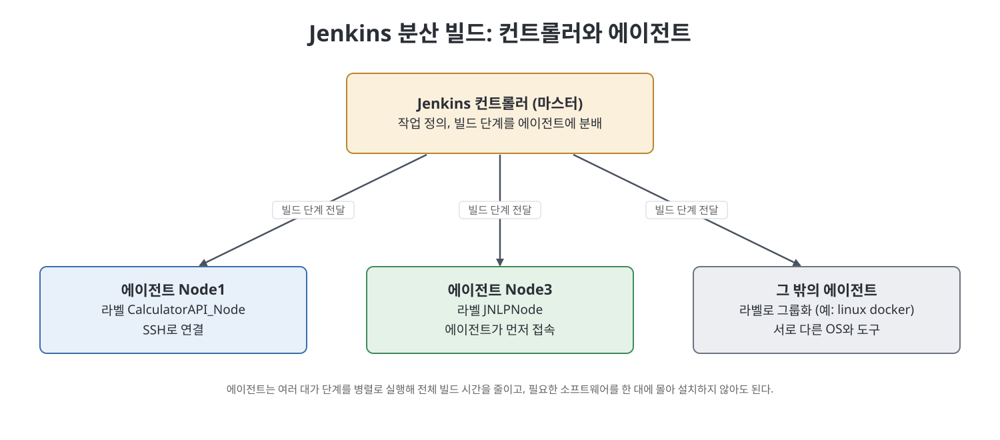
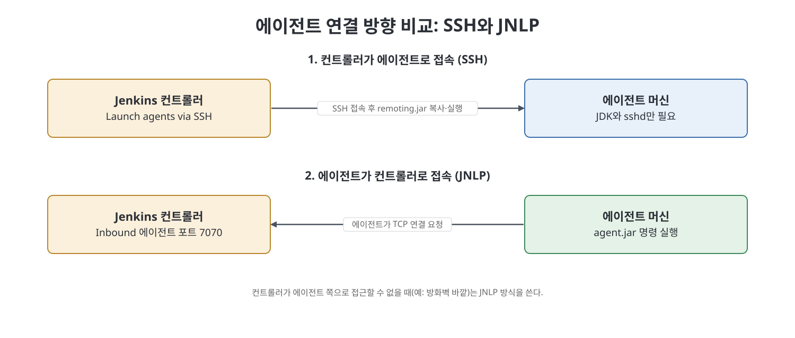

# 17장 분산 빌드 (Jenkins Distributed Builds)

이 장은 지금까지 한 대의 Jenkins 머신에서 돌리던 작업을 여러 머신으로 나누어 실행하는 방법을 다룬다. 한 대로 빌드하면 시간이 오래 걸리는 단계가 순서대로 쌓여 릴리스가 늦어지고, 필요한 소프트웨어를 전부 한 머신에 설치해야 하며, 그 머신이 고장 나면 환경을 다시 만드는 일이 크다. 또 여러 하드웨어·소프트웨어 조합에서 테스트해야 하는 현대 애플리케이션에는 한 대로는 부족하다. 저자는 이 문제를 풀기 위한 Jenkins의 분산 빌드를 설명하고, 에이전트를 연결하는 두 가지 방식(SSH, JNLP)을 따라 하기 형태로 보여 준다.

> **쉽게 말하면**
> 일을 시키는 사람(컨트롤러) 한 명과 실제로 일하는 일꾼(에이전트) 여러 명을 두고, 일꾼마다 맞는 일을 나누어 맡기는 방법이다.

## 이 장의 흐름

1. 컨트롤러-에이전트 구조 이해
2. 컨트롤러와 에이전트를 연결하는 두 방식
3. SSH로 연결: 10단계 설정
4. 프리스타일 job을 특정 노드에서 실행
5. JNLP로 연결: 컨트롤러 설정과 에이전트 실행

## 1. 컨트롤러-에이전트 구조

책은 옛 용어인 master-slave를 쓴다. 노트에서는 "컨트롤러(마스터)"와 "에이전트(슬레이브)"로 적는다.

| 역할 | 하는 일 |
|------|---------|
| Jenkins 컨트롤러(마스터) | Jenkins가 설치된 머신. 빌드의 각 단계를 다른 머신에 보내 실행하게 한다. 책은 이 분배가 단계에 필요한 하드웨어·소프트웨어 요건을 기준으로 이뤄진다고 설명한다. |
| Jenkins 에이전트(슬레이브) | 컨트롤러에 네트워크로 닿는 다른 머신. 에이전트 프로그램이 있어 컨트롤러가 맡긴 단계를 실행한다. 여러 에이전트가 단계를 병렬로 실행해 전체 빌드를 끝낸다. |

> **참고(노트 작성자)** 이 책의 화면은 2021년경 Jenkins 기준이다. 이후 Jenkins 공식 문서와 화면에서는 master 대신 controller, slave 대신 agent라는 용어를 쓴다.

## 2. 컨트롤러와 에이전트를 연결하는 두 방식

연결 방향이 달라진다는 점이 핵심이다.

| 구분 | Master to agent (SSH) | Agent to master (JNLP) |
|------|----------------------|------------------------|
| 누가 먼저 접속하나 | 컨트롤러가 에이전트로 | 에이전트가 컨트롤러로 |
| 에이전트에 필요한 것 | JDK/JRE 정도의 최소 구성 | `agent.jar`를 내려받아 실행할 수 있는 환경 |
| 동작 | 컨트롤러가 SSH 포트로 접속해 `remoting.jar`를 에이전트에 복사하고 실행 | 에이전트가 컨트롤러의 인바운드 에이전트 포트로 TCP 연결 |
| 쓰는 경우 | 컨트롤러가 에이전트에 접근할 수 있을 때 | 컨트롤러가 에이전트에 접근할 수 없을 때(방화벽 바깥 등) |

JNLP는 Java Network Launch Protocol의 약자다. 에이전트를 윈도우 서비스로 설치해 두면 매번 직접 실행하지 않아도 된다고 책은 덧붙인다.

## 3. SSH로 에이전트 연결하기

책은 컨트롤러와 에이전트 두 대의 윈도우 머신으로 따라 하기를 구성한다. 에이전트에는 Jenkins 설치가 필요 없고 JDK 11만 있으면 된다.

1. **SSH Build Agents 플러그인 설치**: 컨트롤러에서 Plugin Manager로 설치한다.
2. **에이전트에 Java 설치**: 설치 절차는 책 범위 밖이다.
3. **SSH 키 쌍 생성**: 컨트롤러에서 `ssh-keygen`을 실행한다. 책은 기본 경로에 암호(passphrase) 없이 만들었다.
4. **개인키 자격 증명 추가**: `Manage Jenkins` > `Manage Credentials`에서 `Global Credentials (Unrestricted)`로 들어가 `Add Credentials`를 누르고 종류로 `SSH Username with Private Key`를 고른다. `Username`에는 에이전트 머신의 실제 사용자 이름을 넣고, `Enter Directly`로 개인키 내용을 붙여 넣는다.
5. **노드 등록**: `Manage Jenkins` > `Manage Nodes and Clouds` > `New Node`에서 이름을 넣고 `Permanent Agent`를 고른다. 이어지는 설정 항목은 아래 표와 같다.
6. **공개키 배치**: 에이전트의 사용자 홈 아래 `.ssh` 폴더에 `authorized_keys` 파일을 만들고 컨트롤러에서 만든 공개키를 붙여 넣는다.
7. **파일 권한 조정**: `authorized_keys`의 `Properties` > `Security` > `Advanced`에서 `Disable Inheritance`를 누르고 상속 권한을 명시 권한으로 바꾼 뒤, SYSTEM과 현재 사용자만 남긴다.
8. **sshd 재시작**: 서비스 목록에서 `OpenSSH SSH Server`를 재시작한다.
9. **접속 확인**: 컨트롤러의 명령 프롬프트에서 `ssh 사용자@에이전트IP`로 접속해 처음 나오는 확인 질문에 `yes`로 답한다. 그러면 `known_hosts` 파일에 에이전트의 키가 기록된다.
10. **노드 실행**: 노드 화면에서 `Relaunch Agent`를 누르면 컨트롤러가 `remoting.jar`를 원격 루트 디렉터리에 복사하고 연결한다.

### 노드 설정 항목

| 항목 | 의미 | 책의 설정 |
|------|------|-----------|
| `Name` | 노드 이름, 유일해야 함 | Node1 |
| `# of executors` | 이 에이전트에서 동시에 돌릴 수 있는 빌드 수 | 1 |
| `Remote root directory` | 에이전트에서 Jenkins가 쓸 전용 폴더. 이 아래에 작업 공간이 생긴다. 에이전트 로컬 경로면 되고 컨트롤러에서 보일 필요는 없다 | C: 드라이브 아래 폴더 |
| `Labels` | 여러 에이전트를 논리적으로 묶는 이름. 여러 개는 공백으로 구분 | CalculatorAPI_Node |
| `Usage` | 이 노드에 빌드를 얼마나 배정할지 | `Use this node as much as possible` (기본값) |
| `Launch method` | 에이전트를 시작하는 방법 | `Launch agents via SSH` |
| `Credentials` | 위에서 만든 개인키 자격 증명 | 4단계에서 만든 항목 |
| `Host Key Verification Strategy` | 에이전트의 SSH 호스트 키를 어떻게 검증할지 | `Known hosts file Verification Strategy` |
| `Node Properties` > `Environment variables` | 에이전트 쪽 환경 변수 | `JAVA_HOME`(Maven이 필요로 함) |

책이 정리한 `Launch method` 선택지는 세 가지 흐름으로 요약된다. 하나는 `Launch agent by connecting to the controller`처럼 에이전트가 먼저 접속하는 JNLP(Java Web Start) 방식, 다른 하나는 컨트롤러가 명령을 실행해 에이전트를 시작하는 방식(PsExec 같은 도구로 원격 실행), 마지막이 SSH로 명령을 보내 시작하는 방식이다. 이 책에서는 SSH를 택했다.

호스트 키 검증 전략은 네 가지다.

| 전략 | 동작 |
|------|------|
| Known hosts file | 실행 계정의 `known_hosts`에 맞는 항목이 있는지 확인 |
| Manually provided key | 설정한 사람이 지정한 키와 원격 호스트의 키가 같아야 함 |
| Manually trusted key | 첫 연결 때 `Computer.CONFIGURE` 권한이 있는 사용자가 키를 승인 |
| Non verifying | 키를 검증하지 않음. 공격 경로가 될 수 있어 권하지 않는다고 책은 말한다 |

책은 Known hosts 방식에서 호스트 키 오류가 날 때의 해법도 적는다. Jenkins가 쓰는 SSH 라이브러리가 `ecdsa-sha2-nistp256` 같은 새 암호 방식을 지원하지 못할 수 있으니 해당 `known_hosts` 항목을 지우고 호스트 키 알고리즘을 `ssh-rsa`로 지정해 다시 만든다는 내용이다.

가용성(`Availability`)은 에이전트를 가능한 한 계속 켜 두는 기본 방식과, 일이 있을 때만 켜고 놀면 끄는 방식 중에서 고른다. 또 Windows 에이전트는 윈도우 원격 관리 기능으로 서비스처럼 제어할 수도 있다고 한다.

> **참고(노트 작성자)** 책의 5번 설정에서 `Remote root directory`는 시스템 루트와 같은 드라이브(C:)에 둔다. 다른 드라이브(D:)를 쓰면 작업 실행 중 오류가 났다고 책은 알려 준다. 윈도우 OpenSSH 환경에서의 관찰이므로 다른 환경에서는 다를 수 있다.

## 4. 특정 노드에서 job 실행하기

노드가 연결되면 프리스타일 job이 그 노드에서 돌도록 지정한다. 책의 예는 CalculatorAPI JAR를 Nexus 저장소에 배포하는 job이다.

1. job 설정에서 `Restrict where this project can be run`을 체크한다.
2. `Label Expression`에 노드 이름이나 라벨(책에서는 Node1)을 적는다.
3. `Source Code Management`에 Git URL을 넣고 빌드 단계는 `mvn deploy`로 둔다.
4. 에이전트가 이미 실행(launch) 중인지 확인한 뒤 job을 실행하면 에이전트 머신에서 수행된다.

## 5. JNLP로 에이전트 연결하기

SSH 방식과 달리 에이전트가 컨트롤러에 접속하므로 컨트롤러 쪽 준비가 먼저다.

1. **컨트롤러에서 인바운드 포트 열기**: `Manage Jenkins` > `Configure Global Security`의 `Agents` 영역에서 `TCP Port for Inbound Agents`를 `Fixed`로 하고 포트를 입력한다(책은 7070). `Agent → Controller Security`의 `Enable Agent → Controller Access Control`을 체크하고 저장한다.
2. **Jenkins URL 설정**: `Manage Jenkins` > `Configure System`의 `Jenkins Location`에서 `Jenkins URL`을 컨트롤러의 실제 주소와 포트로 적는다. localhost를 쓰면 에이전트 머신에서 컨트롤러에 접근할 수 없으니 쓰지 말라고 책은 경고한다.
3. **노드 만들기**: 에이전트 머신에서 컨트롤러 URL로 Jenkins에 접속해 `New Node`를 만든다. `Launch method`는 `Launch agent by connecting to the controller`를 그대로 둔다. 책의 예는 Node3, 원격 루트 `C:\JNLPNode`, 라벨 JNLPNode다.
4. **agent.jar 받기**: 노드 화면의 `agent.jar` 링크로 내려받아 원하는 폴더에 둔다.
5. **실행 명령 사용**: 화면의 `Run from agent command line` 아래에 나오는 `java -jar agent.jar -jnlpUrl ... -secret <값> -workdir ...` 명령을 복사해 `agent.jar` 경로만 내 위치로 고쳐 명령 프롬프트에서 실행한다. `-workdir`는 노드의 원격 루트 디렉터리와 같고, `-secret` 값은 노드마다 다르다. 시크릿 값은 외부에 노출하지 않도록 주의한다.
6. **job 생성**: 같은 방식으로 `Label Expression`에 노드 이름(Node3)을 넣은 job(JNLPNodeJob)을 만들어 실행하면 그 노드에서 수행된다.

## 핵심 정리

- 분산 빌드는 컨트롤러가 단계를 나누고 에이전트가 실행하게 해서 시간, 설치 부담, 단일 장애 지점, 다양한 환경 테스트 문제를 푼다.
- 연결 방식은 컨트롤러가 접속하는 SSH와 에이전트가 접속하는 JNLP, 두 가지가 있다.
- SSH 방식은 키 쌍, 자격 증명, 노드 등록, `authorized_keys` 배치, 접속 확인의 순서로 설정하며, 에이전트에는 JDK만 있으면 된다.
- JNLP 방식은 컨트롤러에 고정 포트와 올바른 Jenkins URL을 먼저 설정하고, 에이전트에서 `agent.jar` 명령을 실행한다.
- job은 `Restrict where this project can be run`과 라벨(또는 노드 이름)로 실행할 노드를 지정한다.

 
 
 

이전: [5부 Readme](Readme.md) | 다음: [18장 AWS 연동](18%EC%9E%A5%20AWS%20%EC%97%B0%EB%8F%99.md)

 

[CICD Pipeline Using Jenkins Unleashed](../)
