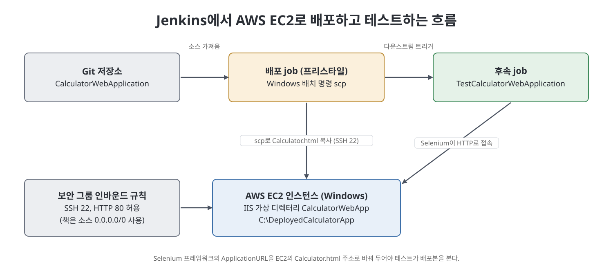

# 18장 AWS 연동 (Integrating Jenkins with AWS)

이 장은 클라우드에 있는 서버에 웹 애플리케이션을 배포하는 과정을 Jenkins로 자동화한다. 저자는 AWS의 가상 서버(EC2 인스턴스)를 하나 만들고, 그 위에 IIS 웹 서버를 설치해 Calculator 웹 애플리케이션을 올릴 자리를 만든 다음, Jenkins job이 `scp` 명령으로 파일을 복사해 배포하고 곧바로 Selenium 테스트 job을 이어서 실행하도록 구성한다. 오늘날 애플리케이션은 사내 서버보다 클라우드 머신에 배포되는 일이 많으므로 AWS 같은 클라우드 이해가 필요하다는 것이 저자의 전제다.

> **쉽게 말하면**
> 클라우드에 빌려 온 빈 컴퓨터에 웹 서버를 깔고, Jenkins가 파일을 그 컴퓨터로 보내 주면서 곧바로 테스트까지 돌리게 만드는 장이다.

## 이 장의 흐름

1. EC2 인스턴스의 개념
2. AWS에서 EC2 인스턴스 만들기
3. 인스턴스에 IIS 설치와 가상 디렉터리 설정
4. 로컬 PC와 인스턴스 사이의 SSH 연결 설정
5. `scp`로 파일 복사, 브라우저 접속 확인
6. 배포 job과 Selenium 후속 job 연결

## 1. EC2 인스턴스란

EC2는 Elastic Compute Cloud의 약자로, AWS 가입자가 필요할 때 가상 서버를 빌려 쓰는 서비스다. 시간 단위로 요금이 매겨지고 요금은 인스턴스 종류에 따라 다르다. CPU와 메모리 요구에 맞춰 만들고, 필요가 없어지면 종료해 비용을 아낄 수 있다. 책은 `t2.micro`, `t2.medium`, `t2.large`처럼 디스크, 프로세서 속도, 메모리가 다른 종류가 있고 `t2.micro` 같은 일부는 무료라고 설명한다. 이 장에서는 무료 종류를 쓴다.

> **참고(노트 작성자)** 무료 제공 범위와 요금 정책은 시기와 계정 상태에 따라 달라진다. 책의 설명은 2021년경 기준이므로 실습 전에 AWS 공식 안내를 확인하는 편이 안전하다.

## 2. EC2 인스턴스 만들기

책은 계정 가입부터 화면별로 짚는다. 요지만 번호로 정리한다.

1. **가입**: AWS 가입 페이지의 `Create a Free Account`에서 정보, 결제 수단, 휴대폰 문자 인증을 거쳐 `Complete Sign Up`을 누른다.
2. **로그인**: `Sign in to the Console`에서 루트 사용자 이메일과 비밀번호로 로그인하고, `All Services`에서 `EC2`를 연다.
3. **인스턴스 시작**: `Launch Instance`에서 `Windows`를 검색해 윈도우 이미지를 고르고, 무료 종류의 인스턴스 유형을 선택한 뒤 `Review and Launch`, `Launch`를 누른다.
4. **키 쌍 생성**: `Select an existing key pair or create a new key pair` 창에서 `Create a new key pair`를 고르고 이름을 입력해 `Download Key Pair`로 `.pem` 파일을 받는다. 이 파일은 로그인 비밀번호를 풀 때 쓰므로 잘 보관한다.
5. **윈도우 접속**: 인스턴스를 선택하고 `Actions` > `Connect` > `RDP Client` 탭에서 `Get Password`를 눌러 `.pem` 파일을 지정하고 `Decrypt Password`로 관리자 비밀번호를 얻는다. `Download Remote Desktop File`로 받은 파일을 열어 그 비밀번호로 접속하면 인스턴스의 바탕화면이 나온다.

## 3. 인스턴스에 웹 서버 준비

### IIS 설치

`Server Manager`에서 `Add Roles and Features`를 열어 `Role-based or feature-based installation`을 유지하고, `Web Server (IIS)` 체크박스를 선택한 뒤 필요한 기능 추가를 허용하고 마법사를 끝까지 진행해 `Install`을 누른다.

### 가상 디렉터리 설정

1. C 드라이브에 빈 폴더 `DeployedCalculatorApp`을 만든다.
2. `Internet Information Services (IIS) Manager`를 열고 `Default Web Site`를 우클릭해 `Add Virtual Directory`를 고른다.
3. `Alias`에 `CalculatorWebApp`, `Physical path`에 위 폴더 경로를 넣는다.

이렇게 하면 브라우저 주소의 `/CalculatorWebApp/` 경로가 그 폴더를 가리키게 된다.

## 4. 로컬 PC에서 인스턴스로 SSH 연결

배포할 `Calculator.html`을 로컬에서 인스턴스로 복사하려면 SSH가 필요하다. 책의 절차는 다음과 같이 이어진다.

1. 로컬 PC에서 `ssh-keygen -t rsa`로 키 쌍을 만든다.
2. 인스턴스에서 `Settings` > `Apps` > `Manage optional features` > `Add a feature`로 `OpenSSH Server`를 설치한다.
3. 인스턴스의 관리자 홈에 `.ssh` 폴더와 빈 `authorized_keys` 파일을 만들고(`fsutil file createnew authorized_keys 0` 사용) 로컬 공개키를 붙여 넣는다.
4. `authorized_keys`의 보안 설정에서 상속을 끊고 명시 권한으로 변환한다.
5. `C:\ProgramData\ssh`의 `sshd_config`에서 마지막 두 줄을 `#`로 주석 처리하고 `OpenSSH SSH Server` 서비스를 재시작한다.
6. AWS 콘솔에서 인스턴스의 `Security` 탭에 있는 보안 그룹으로 들어가 `Edit inbound rules` > `Add rule`에서 유형 `SSH`를 추가한다. 책은 소스를 `0.0.0.0/0`으로 했다.
7. `ssh 사용자@<인스턴스 퍼블릭 DNS>`로 접속을 확인한다.

> **참고(노트 작성자)** 소스 `0.0.0.0/0`은 모든 인터넷 주소에서 접속을 허용한다는 뜻이다. 실습용으로는 간단하지만 실제 운영에서는 허용 범위를 필요한 주소로 좁히는 것이 일반적인 권고다. 책은 이 위험을 따로 논하지 않는다.

| 위치 | 하는 일 |
|------|---------|
| 로컬 PC | 키 쌍 생성, 개인키 보관 |
| EC2 인스턴스(윈도우) | OpenSSH Server 설치, `authorized_keys`에 공개키 배치, `sshd_config` 수정 |
| AWS 보안 그룹 | 인바운드 규칙으로 포트 22(SSH), 이후 HTTP 허용 |

## 5. scp 복사와 브라우저 확인

`scp`는 SSH를 이용해 파일을 원격 머신으로 복사하는 명령이다. 책이 인용한 기본 형태는 개인키 지정 옵션 `-i`, 로컬 파일, `사용자@호스트:원격경로` 순이다. 이 형태로 로컬의 `Calculator.html`을 인스턴스의 `C:\DeployedCalculatorApp`으로 복사한다.

브라우저로 확인하려면 HTTP 연결도 허용해야 한다. SSH 때와 같은 절차로 인바운드 규칙을 추가하되 유형만 `HTTP`로 고른다. 이어서 인스턴스에서 `World Wide Web Publishing` 서비스를 재시작하고, 로컬 브라우저에서 `http://<인스턴스 퍼블릭 DNS>/CalculatorWebApp/Calculator.html`로 접속해 페이지가 뜨는지 본다.

## 6. Jenkins job으로 자동화

1. 프리스타일 job(책에서는 `BuildAndDeployCalculatorWebApplicationOnEC2Instance`)을 만든다. 소스는 CalculatorWebApplication 저장소에서 가져온다.
2. 빌드 단계로 `Execute Windows batch command`에 앞의 `scp` 명령을 넣는다. 개인키 경로는 Jenkins가 돌아가는 계정의 키를 가리킨다. 워크스페이스의 `Calculator.html`이 인스턴스의 배포 폴더로 복사된다.
3. `Post-build Actions`의 `Projects to build`에 `TestCalculatorWebApplication`을 지정해 배포가 끝나면 Selenium 테스트 job이 자동으로 이어지게 한다.
4. Selenium 프레임워크는 지금까지 로컬의 `Calculator.html`을 열었다. 이제 `EnvVars.csv`의 `ApplicationURL`을 EC2 인스턴스 주소로 바꾸어 프레임워크 저장소에 커밋·푸시한다.
5. 배포 job을 실행하면 콘솔에서 복사 결과가 보이고, 끝나는 즉시 상위 job이 배포한 앱을 후속 job이 테스트한다.

### 연결 구성 요약

| 구성 요소 | 역할 | 책의 설정 |
|-----------|------|-----------|
| 배포 job | 소스를 받아 `scp`로 파일 전송, 후속 job 호출 | 프리스타일, 윈도우 배치 명령 |
| EC2 인스턴스 | 배포 대상 서버 | Windows, IIS, `C:\DeployedCalculatorApp` |
| 보안 그룹 | 외부에서 오는 포트 제어 | SSH 22, HTTP 80 허용 |
| 테스트 job | 배포된 앱을 Selenium으로 검증 | `ApplicationURL`을 인스턴스 주소로 변경 |

## 핵심 정리

- EC2 인스턴스는 시간 단위로 빌리는 AWS 가상 서버이며, 키 쌍(`.pem`)으로 윈도우 관리자 비밀번호를 얻어 원격 데스크톱으로 접속한다.
- 윈도우 인스턴스에 IIS를 설치하고 가상 디렉터리를 폴더에 연결하면 그 폴더에 둔 HTML이 웹으로 서비스된다.
- 로컬에서 인스턴스로 파일을 보내려면 OpenSSH Server, `authorized_keys`, `sshd_config` 수정, 보안 그룹의 SSH 인바운드 규칙이 필요하다.
- Jenkins 배포 job은 `scp`로 파일을 복사하고 downstream 설정으로 Selenium 테스트 job을 이어서 실행한다.
- 테스트가 로컬이 아닌 배포본을 보려면 테스트 프레임워크의 `ApplicationURL`을 인스턴스 주소로 바꿔야 한다.

 
 
 

이전: [17장 분산 빌드](17%EC%9E%A5%20%EB%B6%84%EC%82%B0%20%EB%B9%8C%EB%93%9C.md) | 다음: [19장 기타 주제 1](19%EC%9E%A5%20%EA%B8%B0%ED%83%80%20%EC%A3%BC%EC%A0%9C%201.md)

 

[CICD Pipeline Using Jenkins Unleashed](../)
