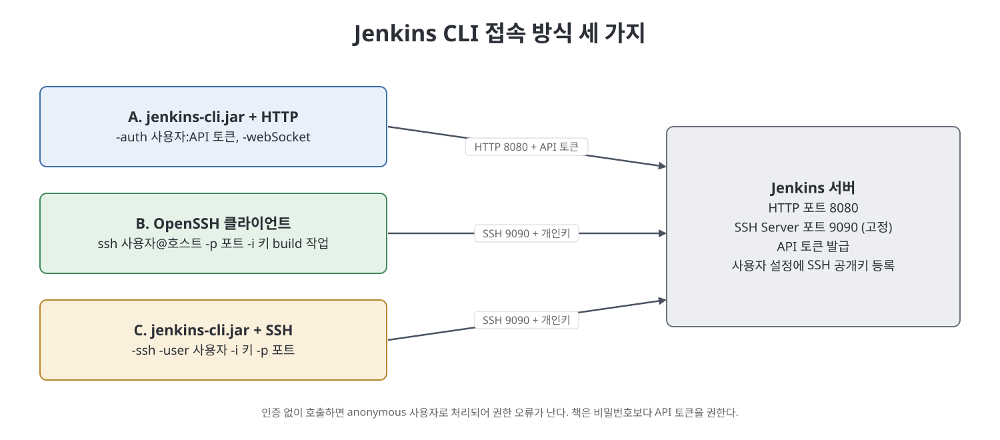

# 19장 기타 주제 1: Jenkins CLI (Miscellaneous Topics Part 1)

이 장은 화면(UI)을 누르는 대신 명령줄이나 스크립트로 Jenkins를 다루는 방법, 곧 Jenkins CLI를 소개한다. 저자는 Jenkins가 GUI와 CLI 두 종류의 인터페이스를 제공하며, 배치 파일이나 셸 스크립트로 서버 접근을 자동화할 수 있다고 설명한다. 핵심은 CLI 클라이언트인 `jenkins-cli.jar`로 작업을 만들고 실행하는 방법, 그리고 호출자를 인증하는 두 방식(API 토큰, SSH 키)이다. 마지막에는 CLI로 모든 작업을 내보내고 다시 가져오는 배치 예제로 마무리한다.

> **쉽게 말하면**
> 마우스로 하던 Jenkins 조작을 명령어 한 줄로 바꾸어, 반복 작업을 스크립트로 자동화하는 방법이다.

## 이 장의 흐름

1. CLI 개요와 `jenkins-cli.jar` 준비
2. `create-job`으로 작업 만들기, 인증 오류 확인
3. API 토큰으로 인증(Basic 인증)
4. SSH 키로 인증: 키 생성, SSH 서버 설정, 방화벽 규칙
5. `build` 명령과 옵션 (OpenSSH 클라이언트 / `jenkins-cli.jar`)
6. 모든 작업 내보내기와 가져오기

## 1. CLI 개요와 준비

`Manage Jenkins` 화면의 `Tools and Actions` 영역에 `Jenkins CLI` 링크가 있고, 여기서 사용 가능한 명령 목록과 설명을 볼 수 있다. CLI를 쓰려면 같은 페이지의 링크에서 `jenkins-cli.jar`를 내려받는다. 이 파일이 CLI 클라이언트 역할을 한다. 명령에는 Jenkins 주소(`-s`)가 필요하다. 아래 표기의 `${}`는 실제 값으로 바꿔 쓸 자리표시자이다.

## 2. create-job과 첫 오류

작업을 만들 때는 작업 이름과, 새 작업의 바탕이 될 설정 XML이 필요하다. 책은 Jenkins 설치 직후 있는 `Demo` 작업의 `config.xml`을 복사해 `Demo.xml`로 쓴다. 기본 형태는 다음과 같다.

```
java -jar jenkins-cli.jar -s ${JENKINS_URL} -webSocket create-job ${JobName} < ${Configuration.xml}
```

인증 없이 이 명령을 실행하면 `anonymous is missing the Overall/Read permission` 오류가 난다. 익명 사용자로 처리되어 작업 생성 권한이 없기 때문이다. 이후 모든 CLI 작업에는 `-auth` 같은 인증 정보가 필요하다.

## 3. API 토큰으로 인증

사용자명과 비밀번호, 또는 사용자명과 API 토큰을 보낼 수 있고, 책은 API 토큰이 더 안전해 권장한다고 말한다.

1. 권한 있는 사용자로 로그인한다.
2. 화면 오른쪽 위의 사용자 이름을 눌러 `Configure`로 들어간다.
3. `API Token` 영역의 `Add new Token`을 누르고 이름을 입력해 `Generate`를 누른다.
4. `Copy this token`으로 복사해 안전한 곳에 보관한 뒤 `Save`를 누른다.
5. 명령에 `-auth ${UserName}:${API_TOKEN}`를 더해 실행한다.

그러면 대시보드에 새 작업이 생긴다. 책은 몇 가지 주의점도 적는다.

- 템플릿 XML에 문법 문제가 있으면 "다른 프로세스가 파일을 쓰고 있다"는 식의 엉뚱한 오류가 나므로 오류 문구만 보고 원인을 단정하지 않는다.
- 같은 이름의 작업이 이미 있으면 `Job Already Exists` 오류가 난다.

> **참고(노트 작성자)** 책의 예제 명령에는 실제 토큰이 노출되어 있다. 토큰이나 비밀번호는 명령 기록과 스크립트에 그대로 남기지 않는 것이 좋다. 노트에서는 모두 자리표시자로 적는다.

## 4. SSH 키로 인증

### 준비 절차

1. **키 생성**: `ssh-keygen -m PEM -t rsa`를 쓴다. `-m PEM`은 개인키를 RSA(PEM) 형식으로 만들게 하는 옵션이다. 옵션이 없으면 OpenSSH 형식이 만들어지는데, 책은 Jenkins CLI 클라이언트가 RSA 형식 개인키를 지원하므로 이 옵션을 빼면 안 된다고 한다.
2. **공개키 등록**: 사용자 이름 > `Configure`의 `SSH Public Keys` 영역에 공개키를 붙여 넣고 저장한다.
3. **SSH 서버 설정**: `Manage Jenkins` > `Configure Global Security`의 `SSH Server` 영역에서 포트를 정한다. `Random`이면 Jenkins가 임의 포트를 쓰는데 방화벽 규칙을 만들기 어려우므로, 책은 `Fixed`를 선택해 9090으로 설정했다.
4. **방화벽 인바운드 규칙**: 윈도우 방화벽(`Windows Defender Firewall with Advanced Security`)에서 `Inbound Rules` > `New Rule` > `Port`를 고르고 `Specific local ports`에 포트(9090)를 입력한 뒤 이름을 붙여 완료한다.

## 5. build 명령과 옵션

`build` 명령에는 아래 옵션이 있다.

| 옵션 | 동작 |
|------|------|
| `-c` | 작업의 SCM에 변경이 있을 때만 빌드를 시작 |
| `-f` | 빌드 결과에 따라 종료 코드를 반환(성공이면 0) |
| `-p` | `Key=Value` 형식으로 빌드 매개변수 전달 |
| `-s` | 빌드가 끝나거나 중단될 때까지 대기(없으면 시작만 하고 돌아옴) |
| `-v` | 빌드의 콘솔 출력을 표시 |
| `-w` | 빌드가 시작될 때까지 대기 |

SSH 인증을 쓰는 방법은 두 가지다.

### 방법 1: OpenSSH(또는 PuTTY) 클라이언트

```
ssh ${JenkinsUser}@${JenkinsHost} -p ${SshPort} -i ${PrivateKeyFile} build ${JOB_NAME}
```

Jenkins 서버의 SSH 포트(9090)와 사용자, 개인키 파일을 지정하고 뒤에 CLI 명령을 붙인다. 책의 실습에서는 `-s -v -c` 옵션을 붙여 한 번 더 실행했다. SCM에 변경이 없을 때는 `-c` 때문에 빌드가 시작되지 않았고, `pom.xml`의 버전을 바꿔 푸시한 뒤 다시 실행하자 빌드가 시작되며 콘솔 로그가 출력되었다.

### 방법 2: jenkins-cli.jar + SSH

이 방법은 먼저 Jenkins가 SSH 서버 주소를 알아야 한다. 기본이 아닌 IP로 Jenkins를 시작한다면 시작 인자 `org.jenkinsci.main.modules.sshd.SSHD.hostName`에 그 IP를 넣어야 한다. `jenkins.war`로 직접 실행하면 `-D` 옵션으로 넘기고(`-D`와 이름 사이에 공백이 없어야 한다), 윈도우 서비스로 실행하면 `jenkins.xml`의 `<arguments>` 안에 추가한 뒤 서비스를 재시작한다.



그 뒤 명령은 다음 형태다.

```
java -jar jenkins-cli.jar -s ${JENKINS_URL} -i ${PrivateKey} -ssh -user ${UserName} ${command}
```

`-ssh`를 쓰면 반드시 `-user`로 사용자를 함께 지정한다. 기본적으로 `jenkins-cli.jar`는 Jenkins 서버가 도는 호스트와 포트로 SSH 연결을 시도하는데, SSH 서버 포트를 따로 지정했다면 `-p` 옵션으로 포트를 알려 준다.

### 접속 방식 비교

| 방식 | 인증 | 사용하는 포트 | 특징 |
|------|------|---------------|------|
| `jenkins-cli.jar` + HTTP | `-auth 사용자:토큰` | Jenkins HTTP 포트 | 가장 기본형. `-webSocket` 지정 |
| OpenSSH 클라이언트 | 개인키 | SSH 서버 포트(9090) | 별도 jar 없이 `ssh` 명령 사용 |
| `jenkins-cli.jar` + SSH | 개인키 | SSH 서버 포트(9090) | `-ssh -user` 필수, 서버에 hostName 설정 필요 |

## 6. 모든 작업 내보내기와 가져오기

Jenkins 서버를 다른 머신으로 옮길 때, 옛 머신에서 작업을 XML로 내보내고 새 머신에서 다시 만들 수 있다. 책은 윈도우 배치 코드로 보여 준다.

| 단계 | 사용하는 CLI 명령 | 동작 |
|------|------------------|------|
| 내보내기 | `list-jobs`, `get-job` | `list-jobs`로 모든 작업 이름을 얻고, 반복문으로 각 작업의 설정을 `get-job`으로 받아 작업명.xml로 저장 |
| 가져오기 | `create-job` | 내보낸 폴더의 각 XML을 반복문으로 읽어, 파일 이름(확장자 제외)을 작업명으로 삼아 `create-job`에 입력 |

가져오기 배치는 `dir /s /b`로 폴더 안 XML의 전체 경로를 얻고, `%%~na`로 파일명을 뽑는 방식이다.

## 핵심 정리

- Jenkins CLI는 GUI의 대안으로, 배치와 셸 스크립트에서 Jenkins를 자동 조작할 때 쓴다. 클라이언트는 `jenkins-cli.jar`다.
- 인증 없이 호출하면 anonymous로 처리되어 권한 오류가 나므로 `-auth`로 사용자와 API 토큰을 보내거나 SSH 키로 인증한다.
- SSH 인증에는 PEM 형식 RSA 키, 사용자 설정의 공개키 등록, SSH 서버의 고정 포트, 방화벽 인바운드 규칙이 필요하다.
- `build` 명령은 `-c`(변경 시에만), `-s`(완료 대기), `-v`(콘솔 출력) 등의 옵션을 제공하며, `ssh` 명령과 `jenkins-cli.jar -ssh` 두 방식으로 호출할 수 있다.
- `list-jobs`, `get-job`, `create-job`을 반복문으로 엮으면 서버 이전용 작업 내보내기·가져오기를 자동화할 수 있다.

<br>
<br>
<br>

이전: [18장 AWS 연동](18%EC%9E%A5%20AWS%20%EC%97%B0%EB%8F%99.md) | 다음: [20장 기타 주제 2](20%EC%9E%A5%20%EA%B8%B0%ED%83%80%20%EC%A3%BC%EC%A0%9C%202.md)

<br>

[CICD Pipeline Using Jenkins Unleashed](../)
