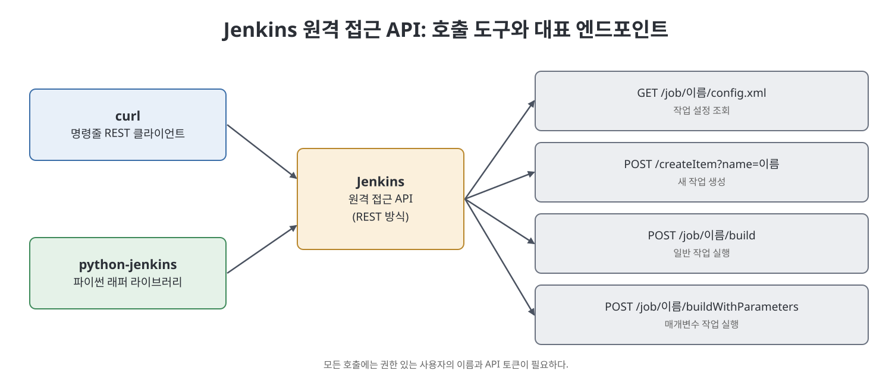
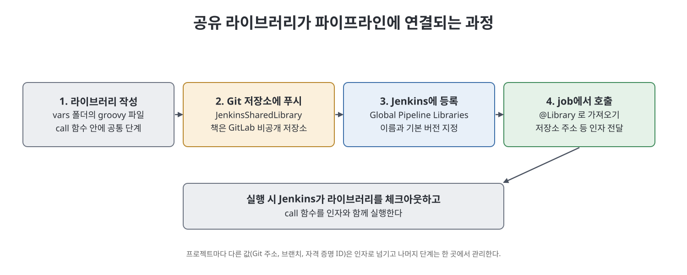

# 20장 기타 주제 2: REST API, python-jenkins, 공유 라이브러리 (Miscellaneous Topics Part 2)

이 장은 CLI로도 부족할 때 쓰는 두 가지 방법과, 파이프라인 코드를 재사용하는 방법을 다룬다. 먼저 Jenkins가 제공하는 원격 접근 API(REST 방식)를 `curl`로 호출해 설정 조회, 작업 생성, 빌드 실행을 해 본다. 이어서 같은 일을 파이썬 래퍼 라이브러리인 python-jenkins로 하고, 마지막으로 여러 파이프라인이 공통으로 쓰는 단계를 Groovy 공유 라이브러리로 묶는다. 이 장은 책의 마지막 본문이며, 저자는 책 전체를 정리하는 말로 끝을 맺는다.

> **쉽게 말하면**
> 프로그램이 Jenkins에 직접 말을 걸게 하는 길(REST API, 파이썬)과, 같은 파이프라인 코드를 복사하지 않고 한 곳에서 가져다 쓰는 길(공유 라이브러리)을 배우는 장이다.

## 이 장의 흐름

1. Jenkins 원격 접근 API와 REST 기초
2. `curl`로 API 호출
3. python-jenkins로 호출
4. 공유 라이브러리 만들고 사용하기

## 1. 원격 접근 API와 REST 기초

Jenkins의 원격 접근 API는 XML, JSON, Python 세 가지 형식을 제공하며 REST 스타일이다. REST API는 HTTP로 호출하는 가벼운 웹 서비스이고, 주소 끝에 `/api/`를 붙이면 해당 대상에 대한 API 정보를 볼 수 있다. 예를 들어 서버 주소 뒤의 `/api/`는 최상위 기능, 곧 설정된 작업 목록을 보여 준다.

| 개념 | 설명 |
|------|------|
| GET | 서버의 리소스 정보를 얻을 때 사용 |
| POST | 작업 같은 새 리소스를 만들 때 사용(책에서는 빌드 실행에도 사용) |
| 쿼리 매개변수 | URL의 `?` 뒤에 `키=값`으로 보냄 |
| 경로 매개변수 | URL 경로 자체에 값이 들어감 |
| 헤더 매개변수 | 요청 헤더로 보냄. 인증 정보가 주로 여기에 해당 |

REST를 호출하려면 클라이언트가 필요하다. 브라우저가 HTML 파일의 클라이언트이듯, 명령줄에서는 `curl`이 널리 쓰인다. 책은 윈도우용 `curl`을 내려받아 `bin` 폴더를 `PATH`에 추가하라고 안내한다.

## 2. curl로 호출하기

모든 호출에는 권한이 있는 사용자의 이름과 API 토큰(19장에서 만든 것)이 필요하다. 형식은 `-u 사용자:토큰`이다. 아래 주소의 서버 부분은 자리표시자로 적는다.

| 목적 | 호출 형태 | 설명 |
|------|-----------|------|
| 작업 설정 조회 | `curl -X GET ${JENKINS_URL}/job/${JOB}/config.xml -u ... -o 저장경로` | 작업의 `config.xml`을 받아 파일로 저장(`-o`) |
| 작업 생성 | `curl -X POST ${JENKINS_URL}/createItem?name=${NEW_JOB} -u ... --data-binary @설정.xml -H "Content-Type:text/xml"` | 쿼리로 작업 이름, 본문으로 설정 XML 전달 |
| 매개변수 작업 실행 | `curl -X POST ${JENKINS_URL}/job/${JOB}/buildWithParameters -u ... -d "이름=값"` | 매개변수를 `이름=값`으로 전달 |
| 일반 작업 실행 | `curl -X POST ${JENKINS_URL}/job/${JOB}/build -u ...` | 매개변수가 없는 작업 |

각 옵션의 뜻도 정리된다. `-X`는 HTTP 메서드, `-u`는 인증 정보, `-o`는 응답을 파일에 저장, `--data-binary @파일`은 파일 내용을 요청 본문으로 전송, `-H`는 요청 헤더 지정이다. 매개변수 작업 예에서는 두 매개변수(배포 디렉터리, 실행할 테스트 종류)를 함께 보내 빌드를 시작하고, 빌드 중 Python Selenium 테스트가 웹 애플리케이션을 검증한다. 책의 URL은 일부가 쪽 넘김으로 잘려 보여, 노트는 일반 형식인 `${JENKINS_URL}/job/${JOB_NAME}/buildWithParameters`로 정리했다.

> **참고(노트 작성자)** 사용자:토큰을 `curl` 명령에 직접 적으면 셸 기록에 남는다. 책의 예제처럼 값을 그대로 쓰기보다 환경 변수 등을 쓰는 편이 안전하다. 또 Jenkins 버전에 따라 POST 호출에 CSRF 보호용 토큰(crumb)이 필요한 설정이 있는데, 책은 이를 다루지 않는다.

## 3. python-jenkins로 호출하기

`curl`은 응답을 그대로 문자열로 주지만, 언어별 래퍼를 쓰면 응답이 해당 언어의 객체(파이썬에서는 딕셔너리 등)로 바뀌어 다루기 쉽다. 책은 JenkinsAPI, python-jenkins, api4jenkins, aiojenkins 같은 파이썬 래퍼가 있다고 소개하고, 그중 python-jenkins로 실습한다.

준비물은 파이썬 인터프리터, 코드 편집기(PyCharm), 그리고 `pip install python-jenkins`로 설치하는 패키지다. 파이썬과 `pip`는 `PATH`에 있어야 한다(15장에서 설명).

| 하고 싶은 일 | 사용하는 호출(책의 예) | 설명 |
|-------------|----------------------|------|
| 서버에 연결 | `jenkins.Jenkins(주소, username=..., password=...)` | 서버 객체를 만든다 |
| 로그인 사용자와 버전 확인 | `get_whoami()`, `get_version()` | 사용자 정보와 Jenkins 버전 출력 |
| 작업 설정 가져오기 | `get_job_config("Demo")` | 설정 XML을 변수에 저장 |
| 작업 만들기 | `create_job(이름, 설정)` | 가져온 설정으로 새 작업 생성 |
| 모든 작업 조회 | `get_jobs()` | 이름, url, color, fullname 키를 가진 딕셔너리 목록 |
| 일반 작업 실행 | `build_job(이름)` | 매개변수 없는 작업 실행 |
| 매개변수 작업 실행 | `build_job(이름, {키: 값})` | 두 번째 인자로 딕셔너리 전달 |
| 작업 삭제 | `delete_job(이름)` | 지정한 작업 삭제 |
| 마지막 완료 빌드 번호 | `get_job_info(이름)['lastCompletedBuild']['number']` | 작업 정보에서 번호 추출 |

책은 이 코드를 담은 프로젝트를 GitLab 공개 저장소에 올렸다고 밝힌다. 예제에서는 비밀번호를 코드에 적었으나, 18장·19장과 같은 이유로 노트에는 옮기지 않는다.

## 4. 공유 라이브러리

여러 작업의 파이프라인에는 같은 단계가 반복되기 쉽다. 예를 들어 CalculatorAPI JAR를 소스 체크아웃, 정리, 테스트, 패키징, 배포로 빌드하는 파이프라인이 있다면, 다른 Java API를 만들 때도 같은 단계를 쓴다. 이때 스크립트를 복사하지 않고 하나의 Groovy 파일에 담아 여러 작업이 가져다 쓰면 중복이 줄고 유지보수가 쉬워진다. 프로젝트마다 달라지는 값(Git 주소, 브랜치, 자격 증명 이름)은 인자로 넘긴다.

1. **라이브러리 파일 작성**: 빈 폴더 안에 `vars` 폴더를 만들고 `buildJavaAPI.groovy`를 둔다. 책은 파일명이 카멜 케이스여야 하고 `.groovy` 스크립트는 `src` 또는 `vars` 폴더 안에 있어야 동작한다고 강조한다. 파일에는 `call`이라는 이름의 함수를 정의한다. 라이브러리를 참조하면 Jenkins는 이 `call` 함수를 호출하며, Java의 `main` 함수와 비슷한 진입점이다. 책의 `call`은 Git 주소, 브랜치, 자격 증명 이름을 받고 선언형 파이프라인(`pipeline { agent any ... }`)으로 `Checkout Code`, `Cleaning workspace`, `Running Testcase`, `Packing Application`, `Deploying Application` 단계를 `git`과 `bat 'mvn ...'` 명령으로 실행한다.
2. **저장소에 푸시**: 새 GitLab 비공개 저장소(JenkinsSharedLibrary)를 만들어 이 파일을 올린다.
3. **Jenkins에 등록**: `Manage Jenkins` > `Configure System`의 `Global Pipeline Libraries`에서 `Add`를 누르고 다음을 입력한다.
   - `Name`: 파이프라인의 `@Library`에서 참조할 이름(책은 BuildJavaAPIs)
   - `Default version`: 라이브러리가 올라간 브랜치(책은 master)
   - `Retrieval method`: `Modern SCM`, 그 아래 `Git`을 고르고 저장소 URL과 자격 증명을 지정
4. **파이프라인 job에서 사용**: 새 파이프라인 job(PipelineJobUsingSharedLibrary)의 `Pipeline` 영역에 두 줄을 쓴다. 첫 줄은 `@Library`로 등록한 이름을 가져오고, 둘째 줄은 `buildJavaAPI(...)`에 Git 주소, 브랜치, 자격 증명 이름을 인자로 넘겨 호출한다.
5. **실행**: job을 실행하면 콘솔에서 Jenkins가 라이브러리를 SCM에서 체크아웃하고 그 안의 파이프라인 코드를 전달받은 값으로 실행하는 것을 볼 수 있다. 다른 Java API 프로젝트에도 인자만 바꾸면 같은 라이브러리를 쓸 수 있다.

> **참고(노트 작성자)** 책의 목록 20-11 본문에는 어노테이션 철자가 잘못 인쇄되어 있다(올바른 형태는 `@Library`). 실습 때는 철자를 확인한다. 또 브랜치 이름 대소문자(master와 Master)가 설정과 호출에서 다르게 적혀 있어, 실제 저장소의 브랜치 이름과 일치시켜야 한다.

### 세 가지 자동화 수단 비교

| 수단 | 쓰는 곳 | 장점 | 책의 예 |
|------|---------|------|---------|
| CLI (19장) | 배치·셸 스크립트 | 간단한 명령 한 줄 | 작업 내보내기·가져오기 |
| REST API + `curl` | 명령줄, 어떤 언어든 HTTP로 | 서버 기능 전반에 접근 | 설정 조회, 작업 생성, 빌드 실행 |
| python-jenkins | 파이썬 프로그램 | 응답이 객체로 오고 코드로 제어 | 작업 관리와 빌드 실행 |

## 핵심 정리

- Jenkins 원격 접근 API는 REST 스타일이며 XML, JSON, Python 형식을 제공한다. 호출에는 권한 있는 사용자의 이름과 API 토큰이 필요하다.
- `curl`로 설정 조회(GET), 작업 생성(POST `createItem`), 빌드 실행(POST `build`, `buildWithParameters`)을 할 수 있다.
- python-jenkins를 쓰면 같은 일을 파이썬 코드로 하고 응답을 객체로 다룰 수 있다.
- 공유 라이브러리는 `vars`(또는 `src`) 폴더의 Groovy 파일 안 `call` 함수에 공통 단계를 두고, `Global Pipeline Libraries`에 등록해 `@Library`로 불러 쓴다.
- 프로젝트별 값은 인자로 넘겨 파이프라인 중복을 줄인다.

 
 
 

이전: [19장 기타 주제 1](19%EC%9E%A5%20%EA%B8%B0%ED%83%80%20%EC%A3%BC%EC%A0%9C%201.md) | 다음: [핵심 정리](%ED%95%B5%EC%8B%AC%20%EC%A0%95%EB%A6%AC.md)

 

[CICD Pipeline Using Jenkins Unleashed](../)
