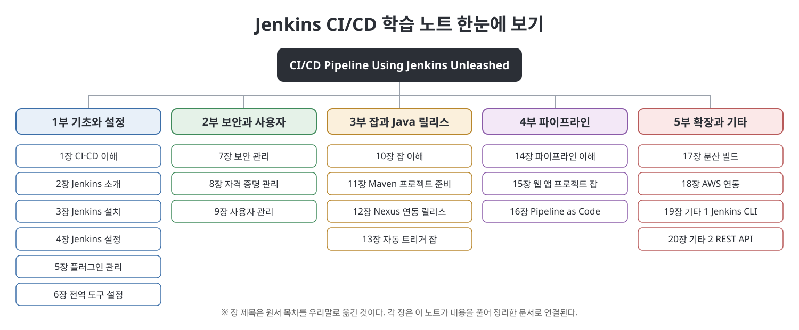

# **CI/CD Pipeline Using Jenkins Unleashed 학습 노트**
(CI/CD Pipeline Using Jenkins Unleashed: Solutions While Setting Up CI/CD Processes, 장별 정리 노트)
 

이 문서는 Pranoday Pramod Dingare의 『CI/CD Pipeline Using Jenkins Unleashed』(Apress, 2022)를 부와 장별로 정리한 한국어 학습 노트입니다. 원문을 번역한 것이 아니라 내용을 우리말로 풀어서 다시 설명했고, 처음 나오는 용어에는 쉬운 풀이를 붙였습니다. 책은 Jenkins를 설치하고 설정하는 일부터 보안과 사용자 관리, Maven과 Nexus를 쓴 Java 릴리스 잡, 파이프라인과 Pipeline as Code, 분산 빌드와 AWS 연동, Jenkins CLI와 REST API까지 20개 장으로 단계별로 안내하는 실무 입문서입니다. 이 노트는 5개 부로 묶어 같은 순서를 따릅니다. 장마다 개념도와 흐름도 같은 그림과 표를 직접 만들어 넣었습니다.

> **이 노트를 읽을 때 유의할 점**
> - 이 노트는 원서의 **요약·해설본**이며 원서를 대신하지 않습니다. 메뉴 이름, 설정 값, 명령 옵션처럼 정확성이 필요한 내용은 반드시 원서와 Jenkins 공식 문서에서 확인하세요.
> - 책의 화면과 절차는 **2021년경 Jenkins 기준**입니다. 최신 버전과 메뉴 위치나 이름이 다를 수 있습니다.
> - 책에 없는 보충 설명은 `참고(노트 작성자)`로 따로 표시했습니다.
> - 예제의 비밀번호, 토큰, IP 같은 값은 자리표시자로 바꿨습니다. 실습할 때는 반드시 자신의 값을 쓰고, 비밀 값을 저장소에 올리지 마세요.
 

---

## 목차

- [1부 기초와 설정 (1~6장)](01.%201%EB%B6%80%20%EA%B8%B0%EC%B4%88%EC%99%80%20%EC%84%A4%EC%A0%95/Readme.md)
  - [1장 CI·CD 이해](01.%201%EB%B6%80%20%EA%B8%B0%EC%B4%88%EC%99%80%20%EC%84%A4%EC%A0%95/01%EC%9E%A5%20CI%C2%B7CD%20%EC%9D%B4%ED%95%B4.md)
  - [2장 Jenkins 소개](01.%201%EB%B6%80%20%EA%B8%B0%EC%B4%88%EC%99%80%20%EC%84%A4%EC%A0%95/02%EC%9E%A5%20Jenkins%20%EC%86%8C%EA%B0%9C.md)
  - [3장 Jenkins 설치](01.%201%EB%B6%80%20%EA%B8%B0%EC%B4%88%EC%99%80%20%EC%84%A4%EC%A0%95/03%EC%9E%A5%20Jenkins%20%EC%84%A4%EC%B9%98.md)
  - [4장 Jenkins 설정](01.%201%EB%B6%80%20%EA%B8%B0%EC%B4%88%EC%99%80%20%EC%84%A4%EC%A0%95/04%EC%9E%A5%20Jenkins%20%EC%84%A4%EC%A0%95.md)
  - [5장 플러그인 관리](01.%201%EB%B6%80%20%EA%B8%B0%EC%B4%88%EC%99%80%20%EC%84%A4%EC%A0%95/05%EC%9E%A5%20%ED%94%8C%EB%9F%AC%EA%B7%B8%EC%9D%B8%20%EA%B4%80%EB%A6%AC.md)
  - [6장 전역 도구 설정](01.%201%EB%B6%80%20%EA%B8%B0%EC%B4%88%EC%99%80%20%EC%84%A4%EC%A0%95/06%EC%9E%A5%20%EC%A0%84%EC%97%AD%20%EB%8F%84%EA%B5%AC%20%EC%84%A4%EC%A0%95.md)
  - [핵심 정리](01.%201%EB%B6%80%20%EA%B8%B0%EC%B4%88%EC%99%80%20%EC%84%A4%EC%A0%95/%ED%95%B5%EC%8B%AC%20%EC%A0%95%EB%A6%AC.md)
- [2부 보안과 사용자 (7~9장)](02.%202%EB%B6%80%20%EB%B3%B4%EC%95%88%EA%B3%BC%20%EC%82%AC%EC%9A%A9%EC%9E%90/Readme.md)
  - [7장 보안 관리](02.%202%EB%B6%80%20%EB%B3%B4%EC%95%88%EA%B3%BC%20%EC%82%AC%EC%9A%A9%EC%9E%90/07%EC%9E%A5%20%EB%B3%B4%EC%95%88%20%EA%B4%80%EB%A6%AC.md)
  - [8장 자격 증명 관리](02.%202%EB%B6%80%20%EB%B3%B4%EC%95%88%EA%B3%BC%20%EC%82%AC%EC%9A%A9%EC%9E%90/08%EC%9E%A5%20%EC%9E%90%EA%B2%A9%20%EC%A6%9D%EB%AA%85%20%EA%B4%80%EB%A6%AC.md)
  - [9장 사용자 관리](02.%202%EB%B6%80%20%EB%B3%B4%EC%95%88%EA%B3%BC%20%EC%82%AC%EC%9A%A9%EC%9E%90/09%EC%9E%A5%20%EC%82%AC%EC%9A%A9%EC%9E%90%20%EA%B4%80%EB%A6%AC.md)
  - [핵심 정리](02.%202%EB%B6%80%20%EB%B3%B4%EC%95%88%EA%B3%BC%20%EC%82%AC%EC%9A%A9%EC%9E%90/%ED%95%B5%EC%8B%AC%20%EC%A0%95%EB%A6%AC.md)
- [3부 잡과 Java 릴리스 (10~13장)](03.%203%EB%B6%80%20%EC%9E%A1%EA%B3%BC%20Java%20%EB%A6%B4%EB%A6%AC%EC%8A%A4/Readme.md)
  - [10장 잡 이해](03.%203%EB%B6%80%20%EC%9E%A1%EA%B3%BC%20Java%20%EB%A6%B4%EB%A6%AC%EC%8A%A4/10%EC%9E%A5%20%EC%9E%A1%20%EC%9D%B4%ED%95%B4.md)
  - [11장 Maven으로 Java API 프로젝트 준비](03.%203%EB%B6%80%20%EC%9E%A1%EA%B3%BC%20Java%20%EB%A6%B4%EB%A6%AC%EC%8A%A4/11%EC%9E%A5%20Maven%EC%9C%BC%EB%A1%9C%20Java%20API%20%ED%94%84%EB%A1%9C%EC%A0%9D%ED%8A%B8%20%EC%A4%80%EB%B9%84.md)
  - [12장 Maven·Nexus 연동과 프리스타일 잡 릴리스](03.%203%EB%B6%80%20%EC%9E%A1%EA%B3%BC%20Java%20%EB%A6%B4%EB%A6%AC%EC%8A%A4/12%EC%9E%A5%20Maven%C2%B7Nexus%20%EC%97%B0%EB%8F%99%EA%B3%BC%20%ED%94%84%EB%A6%AC%EC%8A%A4%ED%83%80%EC%9D%BC%20%EC%9E%A1%20%EB%A6%B4%EB%A6%AC%EC%8A%A4.md)
  - [13장 자동 트리거 프리스타일 잡](03.%203%EB%B6%80%20%EC%9E%A1%EA%B3%BC%20Java%20%EB%A6%B4%EB%A6%AC%EC%8A%A4/13%EC%9E%A5%20%EC%9E%90%EB%8F%99%20%ED%8A%B8%EB%A6%AC%EA%B1%B0%20%ED%94%84%EB%A6%AC%EC%8A%A4%ED%83%80%EC%9D%BC%20%EC%9E%A1.md)
  - [핵심 정리](03.%203%EB%B6%80%20%EC%9E%A1%EA%B3%BC%20Java%20%EB%A6%B4%EB%A6%AC%EC%8A%A4/%ED%95%B5%EC%8B%AC%20%EC%A0%95%EB%A6%AC.md)
- [4부 파이프라인 (14~16장)](04.%204%EB%B6%80%20%ED%8C%8C%EC%9D%B4%ED%94%84%EB%9D%BC%EC%9D%B8/Readme.md)
  - [14장 Jenkins 파이프라인 이해](04.%204%EB%B6%80%20%ED%8C%8C%EC%9D%B4%ED%94%84%EB%9D%BC%EC%9D%B8/14%EC%9E%A5%20Jenkins%20%ED%8C%8C%EC%9D%B4%ED%94%84%EB%9D%BC%EC%9D%B8%20%EC%9D%B4%ED%95%B4.md)
  - [15장 웹 애플리케이션 프로젝트 잡](04.%204%EB%B6%80%20%ED%8C%8C%EC%9D%B4%ED%94%84%EB%9D%BC%EC%9D%B8/15%EC%9E%A5%20%EC%9B%B9%20%EC%95%A0%ED%94%8C%EB%A6%AC%EC%BC%80%EC%9D%B4%EC%85%98%20%ED%94%84%EB%A1%9C%EC%A0%9D%ED%8A%B8%20%EC%9E%A1.md)
  - [16장 Pipeline as Code](04.%204%EB%B6%80%20%ED%8C%8C%EC%9D%B4%ED%94%84%EB%9D%BC%EC%9D%B8/16%EC%9E%A5%20Pipeline%20as%20Code.md)
  - [핵심 정리](04.%204%EB%B6%80%20%ED%8C%8C%EC%9D%B4%ED%94%84%EB%9D%BC%EC%9D%B8/%ED%95%B5%EC%8B%AC%20%EC%A0%95%EB%A6%AC.md)
- [5부 확장과 기타 (17~20장)](05.%205%EB%B6%80%20%ED%99%95%EC%9E%A5%EA%B3%BC%20%EA%B8%B0%ED%83%80/Readme.md)
  - [17장 분산 빌드](05.%205%EB%B6%80%20%ED%99%95%EC%9E%A5%EA%B3%BC%20%EA%B8%B0%ED%83%80/17%EC%9E%A5%20%EB%B6%84%EC%82%B0%20%EB%B9%8C%EB%93%9C.md)
  - [18장 AWS 연동](05.%205%EB%B6%80%20%ED%99%95%EC%9E%A5%EA%B3%BC%20%EA%B8%B0%ED%83%80/18%EC%9E%A5%20AWS%20%EC%97%B0%EB%8F%99.md)
  - [19장 기타 주제 1](05.%205%EB%B6%80%20%ED%99%95%EC%9E%A5%EA%B3%BC%20%EA%B8%B0%ED%83%80/19%EC%9E%A5%20%EA%B8%B0%ED%83%80%20%EC%A3%BC%EC%A0%9C%201.md)
  - [20장 기타 주제 2](05.%205%EB%B6%80%20%ED%99%95%EC%9E%A5%EA%B3%BC%20%EA%B8%B0%ED%83%80/20%EC%9E%A5%20%EA%B8%B0%ED%83%80%20%EC%A3%BC%EC%A0%9C%202.md)
  - [핵심 정리](05.%205%EB%B6%80%20%ED%99%95%EC%9E%A5%EA%B3%BC%20%EA%B8%B0%ED%83%80/%ED%95%B5%EC%8B%AC%20%EC%A0%95%EB%A6%AC.md)

---

## 읽는 순서 제안

| 목적 | 추천 경로 |
|------|-----------|
| Jenkins를 처음 설치하고 둘러보고 싶다 | 1부 (1~6장) |
| 사용자 권한과 비밀 값을 안전하게 관리하고 싶다 | 2부 (7~9장) |
| Java 프로젝트를 빌드해 저장소에 릴리스하고 싶다 | 3부 (10~13장) |
| 파이프라인과 Jenkinsfile을 배우고 싶다 | 4부 (14~16장) |
| 여러 서버로 빌드를 나누거나 외부에서 Jenkins를 제어하고 싶다 | 5부 (17~20장) |
| 전체를 빠르게 복습하고 싶다 | 각 부의 Readme와 핵심 정리 |

## 용어 몇 가지

| 용어 | 쉬운 설명 |
|------|-----------|
| CI/CD | 코드 변경을 자동으로 합치고 검사하고(CI) 배포까지 이어 가는(CD) 개발 방식. |
| Jenkins | 빌드, 테스트, 배포 같은 반복 작업을 자동으로 실행해 주는 오픈 소스 자동화 서버. |
| 잡(Job) | Jenkins가 실행하는 작업 하나의 정의. 프리스타일 잡과 파이프라인 잡이 있다. |
| 파이프라인 | 빌드부터 배포까지의 단계를 코드로 이어 놓은 흐름. |
| Jenkinsfile | 파이프라인을 코드로 적어 저장소에 함께 두는 파일(Pipeline as Code). |
| Maven | Java 프로젝트의 빌드와 의존성을 관리하는 도구. |
| Nexus | 빌드 결과물(아티팩트)을 보관하고 배포하는 저장소 서버. |
| 에이전트(노드) | 컨트롤러의 지시를 받아 실제로 빌드를 돌리는 서버. |

---

## 이 노트에 대하여

- 각 장 문서는 개요, 흐름, 본문 정리, 표, 그림, 핵심 정리, 이전·다음 링크 순서로 구성됩니다.
- 그림은 모두 이 노트용으로 새로 그린 SVG이며 책의 스크린샷이나 삽화를 쓰지 않았습니다.
- 같은 저장소의 다른 학습 노트와 같은 형식을 따릅니다.

