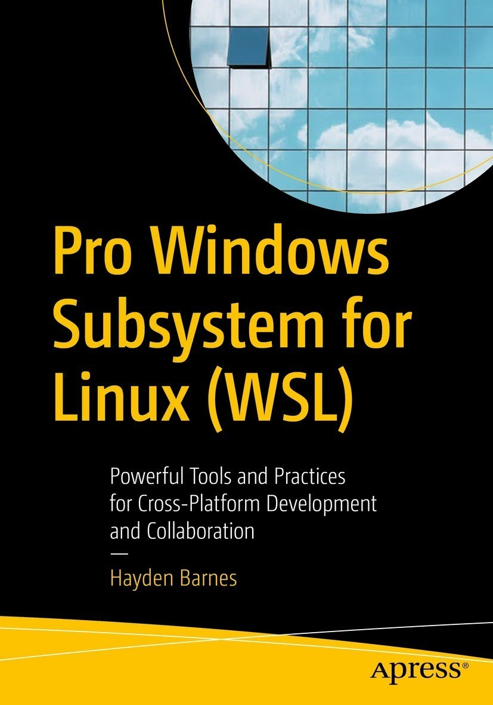
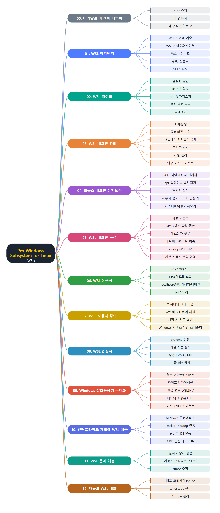

# **Pro Windows Subsystem for Linux (WSL)**
(Pro WSL: 크로스 플랫폼 개발과 협업을 위한 강력한 도구와 실무)
 

 
 

이 문서는 Hayden Barnes가 쓴 『Pro Windows Subsystem for Linux (WSL)』(Apress)를 장별로 정리한 한국어 학습 노트입니다. 원문을 그대로 번역한 것이 아니라 핵심 개념과 명령어를 요약해 다시 정리했습니다. WSL의 구조(WSL 1과 WSL 2)와 설치·활성화에서 시작해 배포판 관리와 유지보수, `wsl.conf`와 `.wslconfig`를 이용한 구성, 사용자 정의, systemd와 커널 빌드 같은 WSL 2 심화 주제를 다룹니다. 이어서 Windows와의 상호운용성, 쿠버네티스·Docker·GPU를 활용한 엔터프라이즈 개발, 문제 해결, 그리고 Intune·Landscape·Ansible을 이용한 대규모 배포까지 이어집니다.
 
 
 

---

- [00. 머리말과 이 책에 대하여](00.%20%EB%A8%B8%EB%A6%AC%EB%A7%90%EA%B3%BC%20%EC%9D%B4%20%EC%B1%85%EC%97%90%20%EB%8C%80%ED%95%98%EC%97%AC/Readme.md)
- [01. WSL 아키텍처](01.%20WSL%20%EC%95%84%ED%82%A4%ED%85%8D%EC%B2%98/Readme.md)
  - [WSL 1 구조와 시스템 콜 변환](01.%20WSL%20%EC%95%84%ED%82%A4%ED%85%8D%EC%B2%98/WSL%201%20%EA%B5%AC%EC%A1%B0%EC%99%80%20%EC%8B%9C%EC%8A%A4%ED%85%9C%20%EC%BD%9C%20%EB%B3%80%ED%99%98.md)
  - [WSL 2 구조와 하이퍼바이저](01.%20WSL%20%EC%95%84%ED%82%A4%ED%85%8D%EC%B2%98/WSL%202%20%EA%B5%AC%EC%A1%B0%EC%99%80%20%ED%95%98%EC%9D%B4%ED%8D%BC%EB%B0%94%EC%9D%B4%EC%A0%80.md)
  - [WSL 1과 WSL 2 비교](01.%20WSL%20%EC%95%84%ED%82%A4%ED%85%8D%EC%B2%98/WSL%201%EA%B3%BC%20WSL%202%20%EB%B9%84%EA%B5%90.md)
  - [GPU 컴퓨트 지원](01.%20WSL%20%EC%95%84%ED%82%A4%ED%85%8D%EC%B2%98/GPU%20%EC%BB%B4%ED%93%A8%ED%8A%B8%20%EC%A7%80%EC%9B%90.md)
  - [GUI와 오디오 지원 계획](01.%20WSL%20%EC%95%84%ED%82%A4%ED%85%8D%EC%B2%98/GUI%EC%99%80%20%EC%98%A4%EB%94%94%EC%98%A4%20%EC%A7%80%EC%9B%90%20%EA%B3%84%ED%9A%8D.md)
- [02. WSL 활성화](02.%20WSL%20%ED%99%9C%EC%84%B1%ED%99%94/Readme.md)
  - [WSL 활성화 방법](02.%20WSL%20%ED%99%9C%EC%84%B1%ED%99%94/WSL%20%ED%99%9C%EC%84%B1%ED%99%94%20%EB%B0%A9%EB%B2%95.md)
  - [배포판 선택과 설치](02.%20WSL%20%ED%99%9C%EC%84%B1%ED%99%94/%EB%B0%B0%ED%8F%AC%ED%8C%90%20%EC%84%A0%ED%83%9D%EA%B3%BC%20%EC%84%A4%EC%B9%98.md)
  - [rootfs 가져오기](02.%20WSL%20%ED%99%9C%EC%84%B1%ED%99%94/rootfs%20%EA%B0%80%EC%A0%B8%EC%98%A4%EA%B8%B0.md)
  - [설치 위치와 WSL 도구](02.%20WSL%20%ED%99%9C%EC%84%B1%ED%99%94/%EC%84%A4%EC%B9%98%20%EC%9C%84%EC%B9%98%EC%99%80%20WSL%20%EB%8F%84%EA%B5%AC.md)
  - [WSL API와 DistroLauncher](02.%20WSL%20%ED%99%9C%EC%84%B1%ED%99%94/WSL%20API%EC%99%80%20DistroLauncher.md)
- [03. WSL 배포판 관리](03.%20WSL%20%EB%B0%B0%ED%8F%AC%ED%8C%90%20%EA%B4%80%EB%A6%AC/Readme.md)
  - [배포판 조회와 실행](03.%20WSL%20%EB%B0%B0%ED%8F%AC%ED%8C%90%20%EA%B4%80%EB%A6%AC/%EB%B0%B0%ED%8F%AC%ED%8C%90%20%EC%A1%B0%ED%9A%8C%EC%99%80%20%EC%8B%A4%ED%96%89.md)
  - [종료와 버전 변환](03.%20WSL%20%EB%B0%B0%ED%8F%AC%ED%8C%90%20%EA%B4%80%EB%A6%AC/%EC%A2%85%EB%A3%8C%EC%99%80%20%EB%B2%84%EC%A0%84%20%EB%B3%80%ED%99%98.md)
  - [내보내기 가져오기 복제](03.%20WSL%20%EB%B0%B0%ED%8F%AC%ED%8C%90%20%EA%B4%80%EB%A6%AC/%EB%82%B4%EB%B3%B4%EB%82%B4%EA%B8%B0%20%EA%B0%80%EC%A0%B8%EC%98%A4%EA%B8%B0%20%EB%B3%B5%EC%A0%9C.md)
  - [초기화와 제거](03.%20WSL%20%EB%B0%B0%ED%8F%AC%ED%8C%90%20%EA%B4%80%EB%A6%AC/%EC%B4%88%EA%B8%B0%ED%99%94%EC%99%80%20%EC%A0%9C%EA%B1%B0.md)
  - [WSL 2 커널 관리](03.%20WSL%20%EB%B0%B0%ED%8F%AC%ED%8C%90%20%EA%B4%80%EB%A6%AC/WSL%202%20%EC%BB%A4%EB%84%90%20%EA%B4%80%EB%A6%AC.md)
  - [외부 디스크 마운트](03.%20WSL%20%EB%B0%B0%ED%8F%AC%ED%8C%90%20%EA%B4%80%EB%A6%AC/%EC%99%B8%EB%B6%80%20%EB%94%94%EC%8A%A4%ED%81%AC%20%EB%A7%88%EC%9A%B4%ED%8A%B8.md)
- [04. 리눅스 배포판 유지보수](04.%20%EB%A6%AC%EB%88%85%EC%8A%A4%20%EB%B0%B0%ED%8F%AC%ED%8C%90%20%EC%9C%A0%EC%A7%80%EB%B3%B4%EC%88%98/Readme.md)
  - [유지보수 개요와 패키지 관리자](04.%20%EB%A6%AC%EB%88%85%EC%8A%A4%20%EB%B0%B0%ED%8F%AC%ED%8C%90%20%EC%9C%A0%EC%A7%80%EB%B3%B4%EC%88%98/%EC%9C%A0%EC%A7%80%EB%B3%B4%EC%88%98%20%EA%B0%9C%EC%9A%94%EC%99%80%20%ED%8C%A8%ED%82%A4%EC%A7%80%20%EA%B4%80%EB%A6%AC%EC%9E%90.md)
  - [패키지 업데이트 설치 제거](04.%20%EB%A6%AC%EB%88%85%EC%8A%A4%20%EB%B0%B0%ED%8F%AC%ED%8C%90%20%EC%9C%A0%EC%A7%80%EB%B3%B4%EC%88%98/%ED%8C%A8%ED%82%A4%EC%A7%80%20%EC%97%85%EB%8D%B0%EC%9D%B4%ED%8A%B8%20%EC%84%A4%EC%B9%98%20%EC%A0%9C%EA%B1%B0.md)
  - [패키지 찾기](04.%20%EB%A6%AC%EB%88%85%EC%8A%A4%20%EB%B0%B0%ED%8F%AC%ED%8C%90%20%EC%9C%A0%EC%A7%80%EB%B3%B4%EC%88%98/%ED%8C%A8%ED%82%A4%EC%A7%80%20%EC%B0%BE%EA%B8%B0.md)
  - [나만의 Ubuntu 이미지 만들기](04.%20%EB%A6%AC%EB%88%85%EC%8A%A4%20%EB%B0%B0%ED%8F%AC%ED%8C%90%20%EC%9C%A0%EC%A7%80%EB%B3%B4%EC%88%98/%EB%82%98%EB%A7%8C%EC%9D%98%20Ubuntu%20%EC%9D%B4%EB%AF%B8%EC%A7%80%20%EB%A7%8C%EB%93%A4%EA%B8%B0.md)
  - [이미지 커스터마이징과 가져오기](04.%20%EB%A6%AC%EB%88%85%EC%8A%A4%20%EB%B0%B0%ED%8F%AC%ED%8C%90%20%EC%9C%A0%EC%A7%80%EB%B3%B4%EC%88%98/%EC%9D%B4%EB%AF%B8%EC%A7%80%20%EC%BB%A4%EC%8A%A4%ED%84%B0%EB%A7%88%EC%9D%B4%EC%A7%95%EA%B3%BC%20%EA%B0%80%EC%A0%B8%EC%98%A4%EA%B8%B0.md)
- [05. WSL 배포판 구성](05.%20WSL%20%EB%B0%B0%ED%8F%AC%ED%8C%90%20%EA%B5%AC%EC%84%B1/Readme.md)
  - [wsl.conf와 자동 마운트](05.%20WSL%20%EB%B0%B0%ED%8F%AC%ED%8C%90%20%EA%B5%AC%EC%84%B1/wsl.conf%EC%99%80%20%EC%9E%90%EB%8F%99%20%EB%A7%88%EC%9A%B4%ED%8A%B8.md)
  - [DrvFs 마운트 옵션과 파일 권한](05.%20WSL%20%EB%B0%B0%ED%8F%AC%ED%8C%90%20%EA%B5%AC%EC%84%B1/DrvFs%20%EB%A7%88%EC%9A%B4%ED%8A%B8%20%EC%98%B5%EC%85%98%EA%B3%BC%20%ED%8C%8C%EC%9D%BC%20%EA%B6%8C%ED%95%9C.md)
  - [대소문자 구분 처리](05.%20WSL%20%EB%B0%B0%ED%8F%AC%ED%8C%90%20%EA%B5%AC%EC%84%B1/%EB%8C%80%EC%86%8C%EB%AC%B8%EC%9E%90%20%EA%B5%AC%EB%B6%84%20%EC%B2%98%EB%A6%AC.md)
  - [네트워크와 호스트 이름 설정](05.%20WSL%20%EB%B0%B0%ED%8F%AC%ED%8C%90%20%EA%B5%AC%EC%84%B1/%EB%84%A4%ED%8A%B8%EC%9B%8C%ED%81%AC%EC%99%80%20%ED%98%B8%EC%8A%A4%ED%8A%B8%20%EC%9D%B4%EB%A6%84%20%EC%84%A4%EC%A0%95.md)
  - [상호운용성과 환경 변수 공유](05.%20WSL%20%EB%B0%B0%ED%8F%AC%ED%8C%90%20%EA%B5%AC%EC%84%B1/%EC%83%81%ED%98%B8%EC%9A%B4%EC%9A%A9%EC%84%B1%EA%B3%BC%20%ED%99%98%EA%B2%BD%20%EB%B3%80%EC%88%98%20%EA%B3%B5%EC%9C%A0.md)
  - [기본 사용자와 부팅 명령](05.%20WSL%20%EB%B0%B0%ED%8F%AC%ED%8C%90%20%EA%B5%AC%EC%84%B1/%EA%B8%B0%EB%B3%B8%20%EC%82%AC%EC%9A%A9%EC%9E%90%EC%99%80%20%EB%B6%80%ED%8C%85%20%EB%AA%85%EB%A0%B9.md)
- [06. WSL 2 구성](06.%20WSL%202%20%EA%B5%AC%EC%84%B1/Readme.md)
  - [.wslconfig와 커널 설정](06.%20WSL%202%20%EA%B5%AC%EC%84%B1/.wslconfig%EC%99%80%20%EC%BB%A4%EB%84%90%20%EC%84%A4%EC%A0%95.md)
  - [프로세서 메모리 스왑 설정](06.%20WSL%202%20%EA%B5%AC%EC%84%B1/%ED%94%84%EB%A1%9C%EC%84%B8%EC%84%9C%20%EB%A9%94%EB%AA%A8%EB%A6%AC%20%EC%8A%A4%EC%99%91%20%EC%84%A4%EC%A0%95.md)
  - [네트워크 가상화 디버그와 레지스트리](06.%20WSL%202%20%EA%B5%AC%EC%84%B1/%EB%84%A4%ED%8A%B8%EC%9B%8C%ED%81%AC%20%EA%B0%80%EC%83%81%ED%99%94%20%EB%94%94%EB%B2%84%EA%B7%B8%EC%99%80%20%EB%A0%88%EC%A7%80%EC%8A%A4%ED%8A%B8%EB%A6%AC.md)
- [07. WSL 사용자 정의](07.%20WSL%20%EC%82%AC%EC%9A%A9%EC%9E%90%20%EC%A0%95%EC%9D%98/Readme.md)
  - [그래픽 앱과 X 서버](07.%20WSL%20%EC%82%AC%EC%9A%A9%EC%9E%90%20%EC%A0%95%EC%9D%98/%EA%B7%B8%EB%9E%98%ED%94%BD%20%EC%95%B1%EA%B3%BC%20X%20%EC%84%9C%EB%B2%84.md)
  - [방화벽과 GUI 문제 해결](07.%20WSL%20%EC%82%AC%EC%9A%A9%EC%9E%90%20%EC%A0%95%EC%9D%98/%EB%B0%A9%ED%99%94%EB%B2%BD%EA%B3%BC%20GUI%20%EB%AC%B8%EC%A0%9C%20%ED%95%B4%EA%B2%B0.md)
  - [시작 시 자동 실행 구성](07.%20WSL%20%EC%82%AC%EC%9A%A9%EC%9E%90%20%EC%A0%95%EC%9D%98/%EC%8B%9C%EC%9E%91%20%EC%8B%9C%20%EC%9E%90%EB%8F%99%20%EC%8B%A4%ED%96%89%20%EA%B5%AC%EC%84%B1.md)
  - [Windows 서비스와 작업 스케줄러](07.%20WSL%20%EC%82%AC%EC%9A%A9%EC%9E%90%20%EC%A0%95%EC%9D%98/Windows%20%EC%84%9C%EB%B9%84%EC%8A%A4%EC%99%80%20%EC%9E%91%EC%97%85%20%EC%8A%A4%EC%BC%80%EC%A4%84%EB%9F%AC.md)
- [08. WSL 2 심화](08.%20WSL%202%20%EC%8B%AC%ED%99%94/Readme.md)
  - [systemd 실행하기](08.%20WSL%202%20%EC%8B%AC%ED%99%94/systemd%20%EC%8B%A4%ED%96%89%ED%95%98%EA%B8%B0.md)
  - [WSL 2 커널 직접 빌드](08.%20WSL%202%20%EC%8B%AC%ED%99%94/WSL%202%20%EC%BB%A4%EB%84%90%20%EC%A7%81%EC%A0%91%20%EB%B9%8C%EB%93%9C.md)
  - [중첩 KVM과 게스트 운영체제](08.%20WSL%202%20%EC%8B%AC%ED%99%94/%EC%A4%91%EC%B2%A9%20KVM%EA%B3%BC%20%EA%B2%8C%EC%8A%A4%ED%8A%B8%20%EC%9A%B4%EC%98%81%EC%B2%B4%EC%A0%9C.md)
  - [WSL 2 고급 네트워킹](08.%20WSL%202%20%EC%8B%AC%ED%99%94/WSL%202%20%EA%B3%A0%EA%B8%89%20%EB%84%A4%ED%8A%B8%EC%9B%8C%ED%82%B9.md)
- [09. Windows 상호운용성 극대화](09.%20Windows%20%EC%83%81%ED%98%B8%EC%9A%B4%EC%9A%A9%EC%84%B1%20%EA%B7%B9%EB%8C%80%ED%99%94/Readme.md)
  - [경로 변환과 wslutilities](09.%20Windows%20%EC%83%81%ED%98%B8%EC%9A%B4%EC%9A%A9%EC%84%B1%20%EA%B7%B9%EB%8C%80%ED%99%94/%EA%B2%BD%EB%A1%9C%20%EB%B3%80%ED%99%98%EA%B3%BC%20wslutilities.md)
  - [Windows와 Linux 간 파이프와 리다이렉션](09.%20Windows%20%EC%83%81%ED%98%B8%EC%9A%B4%EC%9A%A9%EC%84%B1%20%EA%B7%B9%EB%8C%80%ED%99%94/Windows%EC%99%80%20Linux%20%EA%B0%84%20%ED%8C%8C%EC%9D%B4%ED%94%84%EC%99%80%20%EB%A6%AC%EB%8B%A4%EC%9D%B4%EB%A0%89%EC%85%98.md)
  - [환경 변수 공유 WSLENV](09.%20Windows%20%EC%83%81%ED%98%B8%EC%9A%B4%EC%9A%A9%EC%84%B1%20%EA%B7%B9%EB%8C%80%ED%99%94/%ED%99%98%EA%B2%BD%20%EB%B3%80%EC%88%98%20%EA%B3%B5%EC%9C%A0%20WSLENV.md)
  - [네트워크 공유와 FUSE 파일 시스템](09.%20Windows%20%EC%83%81%ED%98%B8%EC%9A%B4%EC%9A%A9%EC%84%B1%20%EA%B7%B9%EB%8C%80%ED%99%94/%EB%84%A4%ED%8A%B8%EC%9B%8C%ED%81%AC%20%EA%B3%B5%EC%9C%A0%EC%99%80%20FUSE%20%ED%8C%8C%EC%9D%BC%20%EC%8B%9C%EC%8A%A4%ED%85%9C.md)
  - [디스크와 VHDX 마운트](09.%20Windows%20%EC%83%81%ED%98%B8%EC%9A%B4%EC%9A%A9%EC%84%B1%20%EA%B7%B9%EB%8C%80%ED%99%94/%EB%94%94%EC%8A%A4%ED%81%AC%EC%99%80%20VHDX%20%EB%A7%88%EC%9A%B4%ED%8A%B8.md)
- [10. 엔터프라이즈 개발에 WSL 활용](10.%20%EC%97%94%ED%84%B0%ED%94%84%EB%9D%BC%EC%9D%B4%EC%A6%88%20%EA%B0%9C%EB%B0%9C%EC%97%90%20WSL%20%ED%99%9C%EC%9A%A9/Readme.md)
  - [Microk8s 쿠버네티스 워크스테이션](10.%20%EC%97%94%ED%84%B0%ED%94%84%EB%9D%BC%EC%9D%B4%EC%A6%88%20%EA%B0%9C%EB%B0%9C%EC%97%90%20WSL%20%ED%99%9C%EC%9A%A9/Microk8s%20%EC%BF%A0%EB%B2%84%EB%84%A4%ED%8B%B0%EC%8A%A4%20%EC%9B%8C%ED%81%AC%EC%8A%A4%ED%85%8C%EC%9D%B4%EC%85%98.md)
  - [Docker Desktop 연동](10.%20%EC%97%94%ED%84%B0%ED%94%84%EB%9D%BC%EC%9D%B4%EC%A6%88%20%EA%B0%9C%EB%B0%9C%EC%97%90%20WSL%20%ED%99%9C%EC%9A%A9/Docker%20Desktop%20%EC%97%B0%EB%8F%99.md)
  - [편집기와 IDE 연동](10.%20%EC%97%94%ED%84%B0%ED%94%84%EB%9D%BC%EC%9D%B4%EC%A6%88%20%EA%B0%9C%EB%B0%9C%EC%97%90%20WSL%20%ED%99%9C%EC%9A%A9/%ED%8E%B8%EC%A7%91%EA%B8%B0%EC%99%80%20IDE%20%EC%97%B0%EB%8F%99.md)
  - [GPU 연산 패스스루](10.%20%EC%97%94%ED%84%B0%ED%94%84%EB%9D%BC%EC%9D%B4%EC%A6%88%20%EA%B0%9C%EB%B0%9C%EC%97%90%20WSL%20%ED%99%9C%EC%9A%A9/GPU%20%EC%97%B0%EC%82%B0%20%ED%8C%A8%EC%8A%A4%EC%8A%A4%EB%A3%A8.md)
- [11. WSL 문제 해결](11.%20WSL%20%EB%AC%B8%EC%A0%9C%20%ED%95%B4%EA%B2%B0/Readme.md)
  - [설치와 가상화 점검](11.%20WSL%20%EB%AC%B8%EC%A0%9C%20%ED%95%B4%EA%B2%B0/%EC%84%A4%EC%B9%98%EC%99%80%20%EA%B0%80%EC%83%81%ED%99%94%20%EC%A0%90%EA%B2%80.md)
  - [리눅스 구성요소 의존성](11.%20WSL%20%EB%AC%B8%EC%A0%9C%20%ED%95%B4%EA%B2%B0/%EB%A6%AC%EB%88%85%EC%8A%A4%20%EA%B5%AC%EC%84%B1%EC%9A%94%EC%86%8C%20%EC%9D%98%EC%A1%B4%EC%84%B1.md)
  - [strace로 애플리케이션 추적](11.%20WSL%20%EB%AC%B8%EC%A0%9C%20%ED%95%B4%EA%B2%B0/strace%EB%A1%9C%20%EC%95%A0%ED%94%8C%EB%A6%AC%EC%BC%80%EC%9D%B4%EC%85%98%20%EC%B6%94%EC%A0%81.md)
- [12. 대규모 WSL 배포](12.%20%EB%8C%80%EA%B7%9C%EB%AA%A8%20WSL%20%EB%B0%B0%ED%8F%AC/Readme.md)
  - [배포 시 고려사항과 Intune](12.%20%EB%8C%80%EA%B7%9C%EB%AA%A8%20WSL%20%EB%B0%B0%ED%8F%AC/%EB%B0%B0%ED%8F%AC%20%EC%8B%9C%20%EA%B3%A0%EB%A0%A4%EC%82%AC%ED%95%AD%EA%B3%BC%20Intune.md)
  - [Landscape로 Ubuntu on WSL 관리](12.%20%EB%8C%80%EA%B7%9C%EB%AA%A8%20WSL%20%EB%B0%B0%ED%8F%AC/Landscape%EB%A1%9C%20Ubuntu%20on%20WSL%20%EA%B4%80%EB%A6%AC.md)
  - [Ansible로 Ubuntu on WSL 관리](12.%20%EB%8C%80%EA%B7%9C%EB%AA%A8%20WSL%20%EB%B0%B0%ED%8F%AC/Ansible%EB%A1%9C%20Ubuntu%20on%20WSL%20%EA%B4%80%EB%A6%AC.md)
